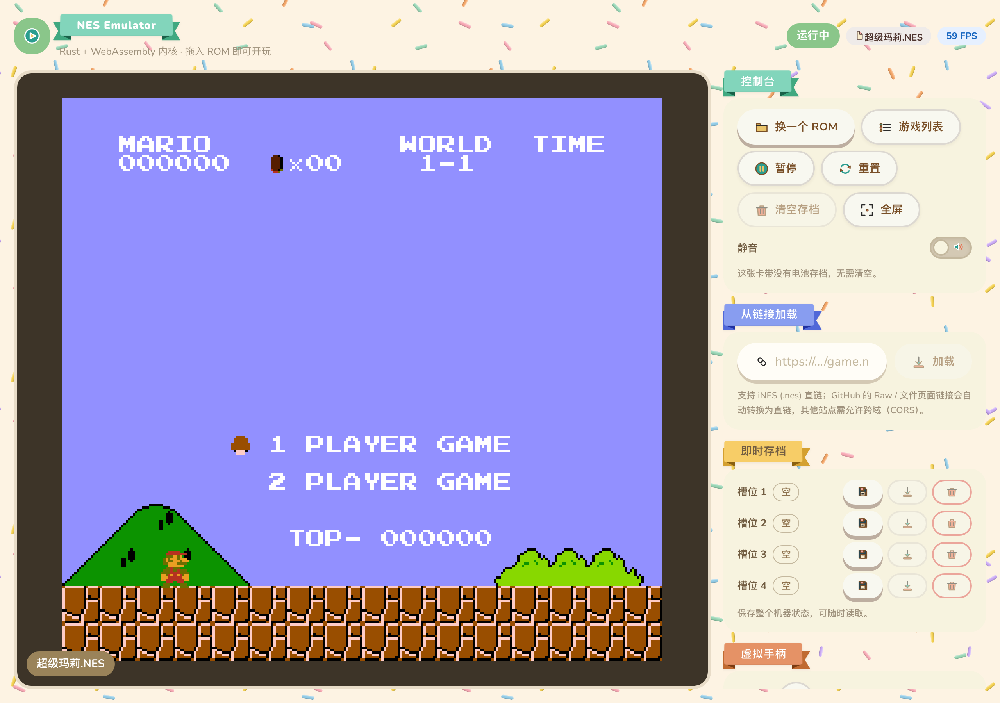

# NES Emulator (Rust + WebAssembly)

[简体中文](./README.zh-CN.md) · **English**

A NES emulator core written in Rust, with WASM bindings and a React web front end:
drag a `.nes` file onto the page, or paste a ROM URL, and start playing.

> The web UI strings are currently Chinese; the docs are English-first, with
> `*.zh-CN.md` alongside each translated page.



## Features

- **CPU**: 6502 (Ricoh 2A03) instruction set, validated by nestest integration tests.
- **PPU**: background and sprite rendering, sprite 0 hit, scanline timing, OAM DMA,
  nametable mirroring.
- **APU**: five channels — two pulses, triangle, noise, DMC — with frame-sequencer IRQ.
- **Mappers**: 33 supported numbers (NROM, MMC1/2/3/4/5, the VRC family, Sunsoft, Irem, …).
- **Expansion audio**: VRC6, MMC5, Sunsoft 5B.
- **Saves**: battery-backed saves (persisted per ROM name) and save states
  (full-machine snapshots, 4 slots).
- **Portable core**: `nes-core` depends on no host bindings; `std` by default, and it
  builds as `no_std` with `--no-default-features`. `Config` can override the TV system
  declared by the cartridge and turn off audio capture, so native front ends
  (Windows / macOS / iOS / Android, …) can trim what they don't need. Frame size, pixel
  format, and the supported mapper list are all exported by the core
  (`WIDTH` / `HEIGHT` / `PIXEL_FORMAT` / `supported_mappers()`), so hosts no longer
  duplicate these constants.
- **Unified pacing**: `FrameClock` turns host timestamps into whole frames; the catch-up
  limit, dropping a backlog after a stall, and FPS statistics all live in the core. Frame
  rate is derived exactly from the cartridge's TV system (NTSC 60.0985 Hz, PAL 50.0067 Hz)
  rather than the customary 60/50. The sub-frame APIs `run_cycles` / `step_instruction`
  are there for finer-grained driving and debugging, so front ends no longer each
  implement their own timers and catch-up logic.
- **Audio straight out**: the sample rate is chosen by the host from its audio device
  configuration (`Config::sample_rate`, 48 kHz by default) and resampling happens in the
  core according to the TV system (following the PPU clock, so PAL no longer plays out of
  tune); `fill_audio` lets hosts pull audio into their own buffers on device-period
  boundaries, so Oboe / CoreAudio / Web Audio no longer each reimplement resampling. The
  queue is bounded: if the host doesn't pull for a long time, the oldest samples are
  dropped instead of piling up without bound.
- **Front end**: three ways to load (drag & drop / URL / game list), a virtual pad,
  integer-multiple pixel scaling, AudioWorklet output, and 4 save-state slots; the UI is
  built on the Animal Crossing–style
  [animal-island-ui](https://github.com/guokaigdg/animal-island-ui) component library.
  See [Web front end](#web-front-end).

## Web front end

React + Vite + TypeScript; the Rust core is compiled to WASM with `wasm-bindgen` and
driven frame by frame in the browser.

### Loading a ROM

- **Drag & drop**: drop a `.nes` file anywhere on the page, or use "选择 ROM" in the
  toolbar.
- **URL**: paste a direct link into "从链接加载" in the sidebar and press Enter; a link
  without `http(s)://` is treated as `https`. GitHub `blob` (file page) and `raw` links
  are rewritten to the direct `raw.githubusercontent.com` URL — the 302 redirect from
  `github.com/…/raw/…` carries no `Access-Control-Allow-Origin`, so the browser discards
  the response outright; other sites must allow cross-origin requests (CORS).
- **Game list**: ships a catalog of the 932 ROMs in
  [mengfei523060/nesrom](https://github.com/mengfei523060/nesrom) (names and direct links
  only, no ROM data), searchable by name and scrollable; the running cartridge is marked
  as the current one. The list is the static `public/games.json`, requested only when the
  dialog is first opened, and can be regenerated with
  `cd web && npm run build:games`.
- All three sources go through the same validation (iNES header + mapper support check);
  a failed load keeps the game that is currently running and explains the reason in a
  notification.

### Controls

- **Keyboard**: see [Key bindings](#key-bindings) below.
- **Virtual pad**: available on touch screens; pressing holds the button down until you
  lift your finger.
- **Pause / resume**: the toolbar button or the `P` key. **Fullscreen**: the
  "全屏" toolbar button, which fills the screen with the picture.

### Picture and sound

- The canvas back buffer is fixed at 256×240, and the CSS size is scaled by **integer
  multiples** (together with `image-rendering: pixelated`), so the blur that fractional
  scaling causes never appears.
- The interleaved stereo samples the core produces for each emulated frame are handed to
  **AudioWorklet**, which plays them at the sound card's pace; browsers without
  AudioWorklet fall back to `ScriptProcessorNode` automatically. Muting is a toolbar
  switch.
- Top-bar status: run state (idle / running / paused / loading), cartridge name (hover to
  see the source), and live FPS.

### Saves

- **Battery saves**: cartridges with a battery write to `localStorage` keyed by ROM name,
  and the save is restored automatically the next time the same cartridge is loaded;
  "清空存档" in the toolbar deletes the save and resets the cartridge after a
  confirmation.
- **Save states**: `save_state` / `load_state` encode the mutable state of the CPU, PPU,
  APU, bus, and cartridge into a byte stream (PRG-ROM is not stored again); 4 slots live
  in IndexedDB and can be saved to, loaded from, or cleared at any time. Loading must
  happen on the same cartridge.

### Interface

- Built on the Animal Crossing–style
  [animal-island-ui](https://github.com/guokaigdg/animal-island-ui) component library;
  `src/styles.css` only handles layout and reads the `--animal-*` variables the library
  exposes — it does not override component colors, corner radii, or shadows.
- Narrow viewports (<940px) switch to a stacked layout automatically: picture on top,
  panels below.
- On a phone browser use **`/m`**: the game list is a page of its own (a dashboard), and
  opening `/m/play?game=<game name>` from the list puts the picture on top with the touch
  pad below, while pause / save / switch-ROM and friends live in a toolbar in the top-right
  corner; in landscape the pad splits to either side of the picture (D-pad on the left,
  A/B on the right). Visiting the root address on a phone enters `/m` automatically, and
  the UI offers no desktop/mobile toggle; see
  [`web/README.md`](web/README.md#mobile-page-m).
- The build strips the fonts and scene illustrations the library doesn't use here, leaving
  `dist/` at about 730 KB. See [`web/README.md`](web/README.md).

## Directory layout

```
crates/nes-core/   emulator core: CPU / PPU / APU / bus / mappers / save-state encoding
crates/nes-wasm/   wasm-bindgen bindings (Nes), a thin wrapper over the core
crates/nes-uniffi/ UniFFI bindings, for iOS / macOS (Swift) and Android (Kotlin)
web/               React + Vite + TypeScript front end
docs/              architecture notes (docs/architecture.md) and UI screenshots (docs/img/)
roms/              local test ROMs (optional; tests that need them are skipped when absent)
```

## Requirements

- Rust 1.70+ (edition 2021)
- Node.js 18+
- `wasm-pack` (only needed when regenerating the WASM bindings)

## Building and running

Core:

```bash
cargo build -p nes-core     # build the core
cargo test --workspace      # run all Rust tests
```

Web front end (generate the WASM bindings first; `web/src/wasm/` is not under version
control):

```bash
cd web
npm install
npm run build:wasm   # generate web/src/wasm with wasm-pack (needs network)
npm run dev          # dev server at http://localhost:5173
npm run build        # typecheck + production build
```

## Deployment (GitHub Pages)

Pushing to `main` triggers
[`.github/workflows/deploy-pages.yml`](.github/workflows/deploy-pages.yml): it compiles
the WASM core on the runner (`web/src/wasm/` is not committed, so it must be regenerated),
then builds the front end, and finally publishes it through the Pages Actions workflow.

First-time use needs one manual step: set **Settings → Pages → Source** in the repository
to **GitHub Actions**. The workflow will not do it for you — GITHUB_TOKEN has no
repository-administration rights. Once enabled, the site is at
`https://<owner>.github.io/<repo>/`.

Vite's `base` is derived by the workflow from the repository name (`/<repo>/` for a normal
repository, `/` for user sites such as `<owner>.github.io`), so a local `npm run build`
still builds for the site root. To reproduce a sub-path build locally (handy when
debugging deployment problems):

```bash
cd web
PAGES_BASE=/<repo>/ npm run build:pages   # output in web/dist
```

Once deployed, the site fetches the ROMs in the game list from
`raw.githubusercontent.com` (which allows cross-origin requests), so it only works
online; offline, use local files or your own direct ROM links.

Pages is purely static hosting with no server-side rewrite, so the build also emits a
`404.html`: when a deep link such as `/m/play?game=…` is requested, it hands the address
back to the app, and `web/src/router.ts` restores it before the first frame, so refreshes
and shared links never land on a 404 page.

## Key bindings

| Action | Keys |
| --- | --- |
| D-pad | `W` `A` `S` `D` |
| A | `J` / `I` |
| B | `K` / `O` |
| Start | `Enter` / `Space` |
| Select | `Shift` |
| Pause / resume | `P` |

On touch devices you can use the virtual pad on the right; on a phone browser prefer the
mobile page at [`/m`](#web-front-end). More front-end detail is in
[`web/README.md`](web/README.md).

## Testing

- `cargo test --workspace`: unit tests + integration tests (`ppu`, `apu`, `mappers`,
  `nestest`) + an end-to-end Super Mario Bros smoke test.
- Tests that need a ROM are skipped or marked `#[ignore]` when `roms/` is missing.
- For front-end changes, run `npm run typecheck` and `npm run build`.

## Notes

- Only the iNES format is supported; the emulator ships no games, so bring your own ROMs.
- ROMs in this repository are never committed; the built-in game list stores names and
  direct links only.

## Disclaimer

A personal, non-commercial study project: there is no commercial activity of any kind, no
ROM or game files are provided or distributed, and the project is not affiliated with
Nintendo. The same statement covers the repository, the web UI, the iOS app, and the other
front ends and bindings; see [`DISCLAIMER.md`](DISCLAIMER.md) for the full text.

## License

MIT (see the `license` field in [`Cargo.toml`](Cargo.toml)).
