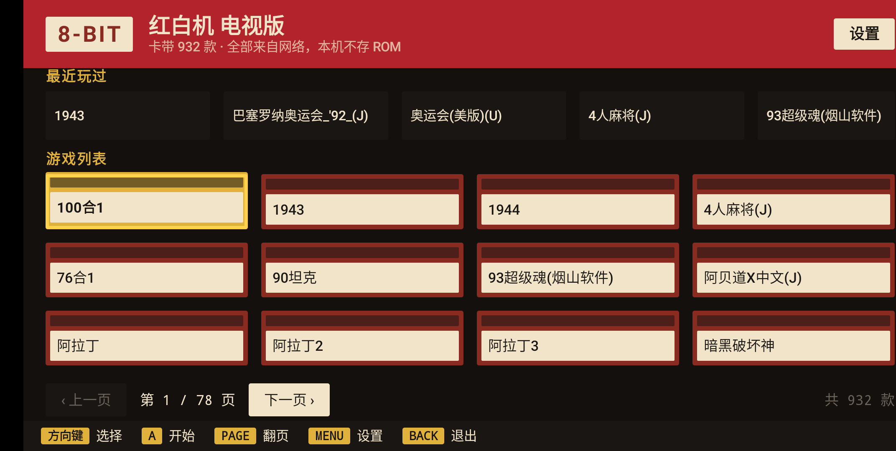
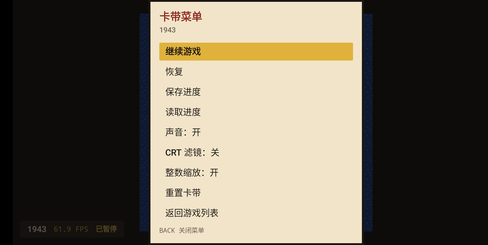

# NES 模拟器 —— Android TV

**简体中文** · [English](./README.md)

基于 Rust 内核的 Android TV 前端：跑的是网页版和 iOS 应用同一个 `nes-core`，用遥控器
方向键或手柄操作，界面是九十年代游戏机的样子。它通过 [`nes-uniffi`](../crates/nes-uniffi)
的 Kotlin 绑定接内核，所以这个应用本身只实现宿主侧的四条通道——喂时间戳、出画面、
收按键、出声音。

- 界面只有中文，与 iOS 应用一致；文档英文优先，旁边配一份中文。
- **不含任何 ROM / 游戏数据**。游戏列表是 Web 端自己的 `web/public/games.json`，构建时
  拷进 APK；打开某一款时才从列表里的链接把它下载到本地，退出这一局就删除。





截图来自 API 30 模拟器；在电视上界面完全一样，只是遥控器方向键做的是这里方向键的事。

## 前置

- **JDK 17** —— Android Studio 自带的那份即可：
  `export JAVA_HOME="/Applications/Android Studio.app/Contents/jbr/Contents/Home"`。
  `./gradlew` 没有它一步都走不了。
- **Android SDK**：platform 34 与 build-tools 34.0.0（用 `ANDROID_HOME`，或写
  `android/local.properties` 里的 `sdk.dir=…`）。
- **Android NDK 26.1.10909125** —— 没有它 `cargo build --target aarch64-linux-android`
  连不起来；`sdkmanager --install "ndk;26.1.10909125"` 装一个。
- **`cargo-ndk`** —— `cargo install cargo-ndk --locked`。只有它会把链接器指到对应 ABI 的
  NDK，`cargo build --target` 自己做不到。
- 仓库固定的 Rust 工具链：`rust-toolchain.toml` 里已经列了三个 Android target，第一次跑
  cargo 时 rustup 会自动装好。

## 命令

```bash
./android/build-core.sh                # 编内核 + 生成 Kotlin 绑定（两个 ABI）
./android/build-core.sh arm64-v8a      # 只编一个 ABI，快速验证用

cd android
./gradlew :app:assembleDebug           # 出 APK
./gradlew :app:testDebugUnitTest       # 跑应用自己的 JVM 单测
./gradlew :app:installDebug            # 装到已连接的设备或模拟器
```

`build-core.sh` 产出两样生成物，都不提交：`app/src/main/jniLibs/<abi>/libnes_uniffi.so`
和 `app/src/main/java/uniffi/` 下的 Kotlin API。新克隆的仓库要先跑一次它，Gradle 才能编译。

## ABI

一共四个，因为 APK 里没有匹配的 ABI 时 Android 直接拒绝安装，而不是装完再报错：

| ABI | 谁在跑 |
| --- | --- |
| `arm64-v8a` | 现在的电视盒子与电视机 |
| `armeabi-v7a` | 64 位芯片上跑 32 位 Android 用户态的机型，索尼 BRAVIA 系列就在其中 |
| `x86_64` | 64 位模拟器镜像 |
| `x86` | Google 自己的 Android TV 系统镜像（到 API 31 都是 32 位） |

目标设备上 `adb shell getprop ro.product.cpu.abilist` 会告诉你它要哪一个；名单同时写在
`build-core.sh` 和 `app/build.gradle.kts` 的 `abiFilters` 里，两处必须一致。

## 在模拟器上试

```bash
export JAVA_HOME="/Applications/Android Studio.app/Contents/jbr/Contents/Home"
"$ANDROID_HOME/cmdline-tools/latest/bin/sdkmanager" --install "system-images;android-30;android-tv;x86"
"$ANDROID_HOME/cmdline-tools/latest/bin/avdmanager" create avd -n nes-tv -k "system-images;android-30;android-tv;x86"
"$ANDROID_HOME/emulator/emulator" -avd nes-tv
```

除了 TV 桌面本身，手机镜像验证其它一切都一样——界面本来就是方向键驱动的。用 `adb` 时
`input keyevent KEYCODE_DPAD_*` 走焦点，`KEYCODE_MENU` 打开设置或游戏内菜单。

## 代码怎么分

| 文件 | 负责什么 |
| --- | --- |
| `NesSession.kt` | 机器和它的线程：专用模拟线程跑帧、把声音推进环形缓冲、把画面交给画面表面；GL 线程的 swap（同一时刻只有一帧在飞）才是放行下一帧的东西 |
| `VideoSurface.kt` | `WHEN_DIRTY` 模式的 `GLSurfaceView`：一张 GLES2 纹理、整数倍缩放、可选扫描线 |
| `AudioOutput.kt` | 独立线程里的 `AudioTrack`，按设备自己的采样率抽干 `AudioRing` |
| `InputMapper.kt` | 按键与摇杆事件映射到主机那八个键，含连发 |
| `AppState.kt` | 流程：当前哪个界面、在下载什么、游戏上盖着哪个面板 |
| `ui/` | 各个界面以及它们取色的调色板 |
| `GameCatalog.kt`、`RomDownloader.kt`、`SaveStore.kt`、`Recents.kt`、`Settings.kt` | 列表、一次性下载，以及留在本机的东西 |

动手改之前，有三件事值得先知道：

- **内核是单一属主的。** 每一次进入 `Nes` 的调用都发生在模拟线程上
  （`docs/architecture.md` §10.5）；音频线程只碰环形缓冲，GL 线程只负责报告
  "一帧画面已经上屏"。整个应用里只有 `NesSession` 持有 `Nes`。
- **画面是以字节过去的。** Kotlin 解不了 `frame_buffer_ptr()`，而 `frame_buffer()` 会
  把 61440 个像素逐个装箱跨越边界，所以绑定层为它加了 `frame_buffer_bytes()`：每帧一个
  `ByteArray`，按 `GL_RGBA` 上传，在片元着色器里用 `.bgr` 调回来（字节是
  `0xAARRGGBB` 的小端序，所以像素是蓝色在前）。
- **下载不是收藏。** 卡带只落到缓存里的一个文件，退出这一局就删掉；电池存档和四个即时
  存档槽按游戏名存放，比卡带活得久。

## 电视上的性能

这个前端里有三处决定在目标硬件上真正换回了帧，都是在索尼 BRAVIA 4K VH22 上量的
（四核 Cortex-A55 1.8GHz、32 位 Android 用户态、1080p）：

- **显示链路就是节拍器，swap 就是那一拍。** 这里没有任何定时器。GL 线程每上屏一帧就
  报告一次，是这个报告——而不是某个时钟——放行模拟线程跑下一帧；于是刚做好的那一帧在
  下一个 vsync 就上屏，而画面表面一旦停止呈现，机器也就停下来，而不是自己空转下去。
  之前两版设计在这台机器上都失败了。`Choreographer` 每 ~84ms 才给一次回调（五个 vsync
  里只给一个：系统会节流一个并非正在被合成的应用的显示链路），`FrameClock` 只拿到五分之一
  的时间戳，稳稳卡在 50fps。换成 `System.nanoTime()` 定时器后问题更隐蔽：一帧要 ~15ms 才能
  模拟完，于是每次唤醒都跑一批、只把最新的一帧交出去，画面表面每秒只收到 17 张图，而屏幕
  上的计数器还写着 60——它数的是模拟帧，不是呈现帧（现在数呈现帧了）。
- **内核采样率跟着面板走。** 把 NTSC 卡带按 60.000004Hz 的面板来跑，游戏会慢 0.16%——
  这也是 RetroArch 在这台电视上的取舍——所以设备放 48000 时，内核被要求每个"模拟秒"产出
  48079 个采样；不这么做，环形缓冲大约二十分钟后就会见底。算式的归属在 `AudioRate` 里，
  代价是 0.16% 的音高，听不出来。
- **关掉内核的 PPU 总线轨迹。** 它一帧要在 89342 个 dot 上各记一条样本，而这个前端
  从来不读它。值 5–8%。

剩下的就是模拟本身：

| | 每帧 |
| --- | --- |
| 模拟（`Nes::frame` 加输入） | 约 14.4ms |
| 本前端（画面 + 音频管道） | 约 1.7ms |
| 60Hz 的预算 | 16.67ms |

也就是说一个核心的约 95% 都被占满，这正是循环落在 ~59.5fps 而不是 60.0 的原因：一个 vsync
只够"模拟"，不够"模拟 + 上传"，所以撞上调度抖动的那些帧会晚一个 vsync 上屏，而不是被丢掉。
瓶颈是内核逐 dot 的 PPU 与 CPU 工作，不是这个宿主——同一份构建在手机、64 位盒子或模拟器上
都有余量，PAL 卡带（50Hz）更是每六个 vsync 跳一个而已。另外两件**没有**效果的事也记在这里，
免得再试一遍：给 `armeabi-v7a` 打开 NEON / ARMv8 代码生成没有任何可测量的变化，关掉内核的
音频采集也一样（重采样不是耗时所在）。

想自己看呈现速率：先 `adb shell dumpsys SurfaceFlinger --latency-clear "<layer>"`，玩几秒，
再 `--latency` 一次。在这台电视上，这份 dump **不是**应用帧率的证据：只要该 layer 手上还有
任何 buffer，它就每个 vsync 记一条——暂停游戏再采样，同样会得到 2.1 秒内 127 条。它能抓到
"整几个 vsync 都没排队任何东西"的前端（改之前这里量到五秒 85 条），但分辨不出每秒排队 55 帧
和 60 帧。靠谱的读数是屏幕上的计数器（呈现帧，不是模拟帧），以及上面那张每帧成本表；在
`frame()` 前后和这一轮其余部分前后临时插一对 `System.nanoTime()` 就能复现。

## 按键

| 手柄 | 主机 |
| --- | --- |
| 方向键、左摇杆、十字帽 | 十字键 |
| A、方向键中键、Y | A 键 |
| B、X | B 键 |
| START | START |
| SELECT | SELECT |
| R1 / R2、L1 / L2 | 连发 A、连发 B |
| MENU | 设置，或游戏内菜单 |
| BACK | 退一层：关菜单、退出游戏、退出应用 |

游戏列表用列表下方那两个按钮翻页——按 `A` 翻一页、焦点留在按钮上，所以连翻几页只要一直按同一个
键。`PAGE` / `CHANNEL` 键同样翻页，长按方向键则一次快翻四行；翻到头的那一侧按钮是变暗而不是消失。

遥控器永远是 1P；手柄按被发现的顺序接 1P、2P，所以双人游戏只要多一只手柄。

## 还没做

- 改键（设置里放的是一张只读对照表）。
- 导入自己已有的 ROM：目前只支持列表里的链接，所以玩起来要联网。
- 原生低延迟音频（Oboe/AAudio）：现在用的是 `AudioTrack`。采样率已经跟随设备。
- 触屏界面：布局是方向键驱动的，没有手柄的手机能浏览，但玩起来别扭。
- 发布签名、体积裁剪和上架用的 TV 清单。

## 免责声明

本应用是纯个人学习研究项目：不提供也不分发任何 ROM / 游戏文件，自身不会主动下载东西，
与任天堂没有任何关联。设置里的「关于与免责声明」在应用内展示同一份声明，完整内容——
涵盖仓库、Web UI、iOS 应用与本应用——见 [`../DISCLAIMER.zh-CN.md`](../DISCLAIMER.zh-CN.md)。
