# NES Emulator Technical Architecture

[简体中文](./architecture.zh-CN.md) · **English**

This document describes the repository's technical architecture, its core runtime model,
the host integration contract, and where things are heading. The goal is for a newcomer to
build a complete mental model within an hour, and for an engineer about to integrate a new
platform (iOS / Android / macOS / Windows) to know what to implement and what not to.

- Applies to: `main` (as of 2026-10-12)
- Code size: ~31k lines of Rust (~25k of them in `crates/nes-core/src`), ~2.8k lines of TypeScript
- Test suite: 806 tests (all passing), including the nestest, blargg and
  AccuracyCoin real-ROM suites (which skip without ROMs in `roms/`)

---

## 1. Design goals and principles

The whole project revolves around one line: **separate "what a NES is" from "how it is
presented to the user" completely.**

| Principle | How it is realized |
| --- | --- |
| Core has zero host dependencies | `nes-core` references no platform API and no `wasm-bindgen`; it compiles under `no_std` |
| Bindings only move data | Every method in `nes-wasm` is a 1:1 forwarding to the core, with no business logic |
| The core publishes the host contract | Resolution, pixel format, mapper list, frame rate, and audio sample rate are all exported by the core, so hosts don't copy constants |
| Deterministic behavior | At any driving granularity (whole frame / slice / single instruction), the machine state at the same frame boundary is byte-for-byte identical |
| Time and devices belong to the host | The core has no timers and no threads; pacing is unified by `FrameClock`, and audio is pulled at the device rate |
| Portable to any front end | A host only has to implement four things: feed timestamps, pull audio, draw pixels, send button presses |

---

## 2. Layering and repository structure

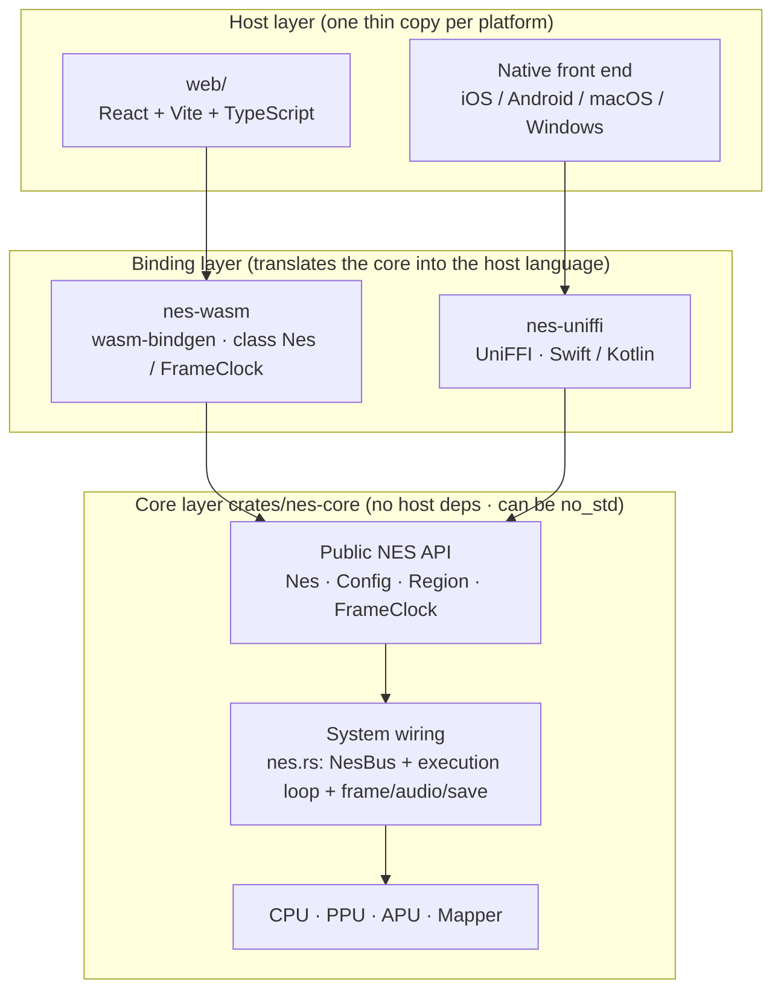

### Directory responsibilities

| Path | Responsibility | Dependency direction |
| --- | --- | --- |
| `crates/nes-core/` | Emulator core: CPU / PPU / APU / bus / mapper / save-state encoding / pacing components | Only `bitflags` at runtime |
| `crates/nes-wasm/` | `wasm-bindgen` bindings, with `src/lib.rs` as a thin wrapper | → `nes-core` |
| `crates/nes-uniffi/` | UniFFI bindings, for Swift (iOS/macOS) and Kotlin (Android) | → `nes-core`, `uniffi` |
| `web/` | React + Vite front end: canvas rendering, Web Audio, save persistence, controller UI | → `web/src/wasm` (generated) |
| `ios/` | Minimal runnable iOS app: Metal picture, AVAudioEngine audio, virtual pad; the Rust static library is produced by `ios/build-core.sh` | → `crates/nes-uniffi` |
| `web/src/wasm/`, `crates/nes-wasm/pkg/` | `wasm-pack` output, **not committed** (regenerated by `npm run build:wasm`) | — |
| `docs/` | This document and the UI screenshots | — |
| `roms/` | Local test ROMs, **not committed**; tests that need them are skipped when absent | — |

### Core module map

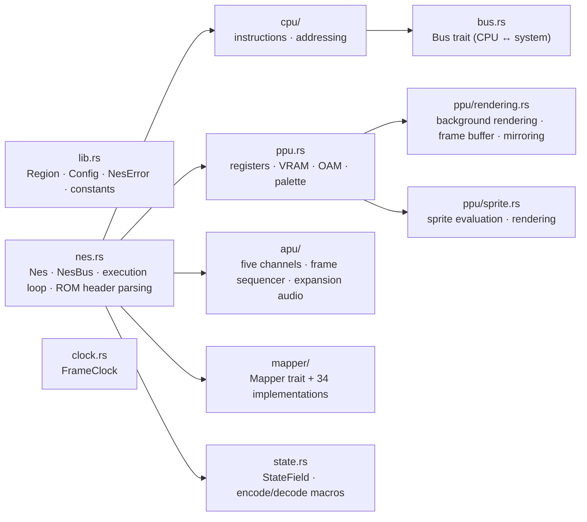

---

## 3. Core runtime model

### 3.1 Clock and TV system

The core's smallest unit of time is the **CPU cycle**, and it hard-assumes **1 CPU cycle =
3 PPU dots** (`PPU_DOTS_PER_CPU_CYCLE`, see `crates/nes-core/src/nes.rs`). The duration of a
frame follows from the scanline count rather than a hardcoded 60 Hz:

| Metric | NTSC | PAL |
| --- | --- | --- |
| Scanlines / frame | 262 | 312 |
| PPU dots / scanline | 341 | 341 |
| PPU clock | 5,369,318 Hz | 5,320,313 Hz |
| CPU cycles / frame | 29,780 | 35,464 |
| **Frame rate (published by the core)** | **60.0985 Hz** | **50.0067 Hz** |

Frame rate is derived by `Region::fps() = ppu_clock_rate / (341 × scanlines)`, and hosts get
it from `Nes::frame_rate()`. **Do not assume 60 Hz** — a PAL cartridge is 50.0067 Hz, and a
PAL frame is longer.

> **Implementation note**: the APU sample clock likewise uses `ppu_clock_rate / 3` (i.e. the
> rate at which the machine actually advances the CPU), not the cartridge's nominal CPU
> clock. A real PAL board's PPU:CPU ratio is 3.2:1, while the core models it as 3:1, so the
> nominal CPU clock and the implementation disagree; audio that kept using NTSC constants
> would play about 7.6% out of tune.

### 3.2 Executing one frame

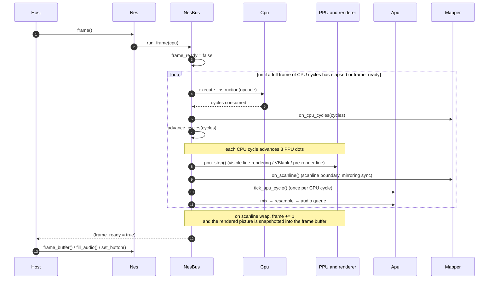

Key points:

- **Rendering happens as the machine runs**: the background renderer keeps writing to its
  own working buffer, and only at a frame boundary does it `copy_from_slice` into the
  externally visible `FrameBuffer`. So mid-frame reads always see the **previous complete
  frame**, and there is no tearing.
- **PPU writes are decoupled from rendering**: rendering uses a separate `ppu.render_v`
  scroll counter, so the CPU changing `v` through `$2006/$2007` doesn't corrupt the frame
  being rendered.
- **DMA stalls the CPU**: OAM DMA (`$4014`) stalls it for 513/514 cycles and a DMC byte
  fetch for 4 cycles; PPU and APU keep advancing during the stall.

### 3.3 Three driving granularities

| API | Semantics | Use |
| --- | --- | --- |
| `Nes::frame()` | Run a full frame (or stop early at a frame boundary) | Ordinary front ends, paired with `FrameClock` |
| `Nes::run_cycles(n)` | Run at most n CPU cycles, stopping early at a frame boundary; returns the cycles actually run | Sub-frame scheduling, audio driving, precise catch-up |
| `Nes::step_instruction()` | Execute one instruction, returning its cycle count | Debuggers, single-step regression |

All three share the same single-step implementation (`NesBus::step_instruction`), so
**sliced execution and whole-frame execution produce exactly the same result** — regression
tests compare `save_state()` byte for byte. The `frame_ready` flag has the same meaning in
all three: `frame()` / `run_cycles()` clear it on entry and set it during execution, while
`step_instruction()` leaves it alone, so single-stepping across a frame boundary still lets
you observe the flag.

---

## 4. The full path: from a ROM file to playable

The previous sections covered how the machine ticks; this one covers **what a `.nes` file
actually goes through from being selected to letting you control a character.** The whole
path does just three things: **validate → insert the cartridge and reset → run the machine
frame by frame at the right pace.**

### 4.1 End-to-end sequence

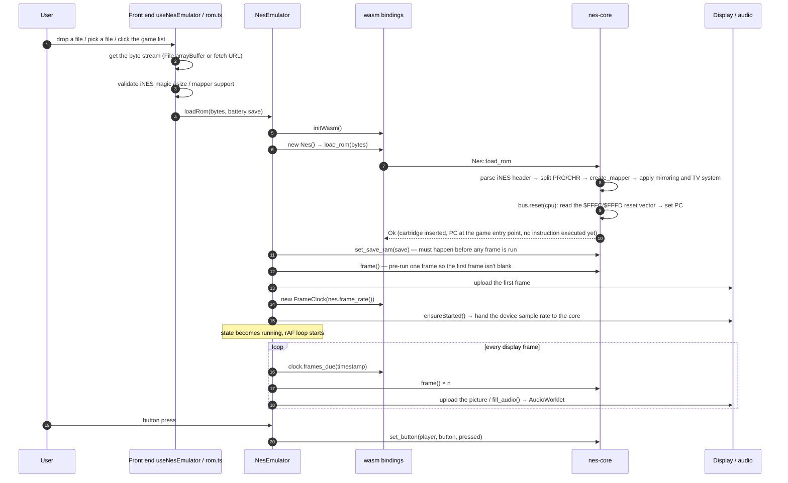

### 4.2 Core side: insert the cartridge and reset (`Nes::load_rom`)

| Step | Code location | Notes |
| --- | --- | --- |
| Parse the iNES header | `RomHeader::parse` | Magic `NES\x1a`; PRG/CHR sizes (in 16 KB / 8 KB units); mapper number = flags7 high nibble + flags6 high nibble; mirroring; TV system (flags9 bit0 / flags10); battery flag (flags6 bit1); skip 512 bytes when a trainer is present |
| Split the ROM | `NesBus::load_rom` | PRG must be complete, else `InvalidRomFormat`; a CHR length of 0 means CHR-RAM, built by the mapper |
| Build the cartridge | `create_mapper` | Returns `UnsupportedMapper` for an unimplemented number (the front end already rejected it earlier; this is the backstop) |
| Apply cartridge properties | `NesBus::load_rom` | Mirroring is written to both the renderer and the bus; the TV system prefers `Config::region_override`, otherwise the header declaration |
| Reset the CPU | `Cpu::reset` | `SP -= 3`, set the I flag, **PC = [$FFFC] \| [$FFFD] << 8**, cycle counter cleared |

**The key point: `load_rom` only inserts and resets — it does not execute a single
instruction.** When the function returns, the machine is at the instant right after the
reset button was pressed: PC already points at the game's entry point in the cartridge, but
not one line of game code has run.

### 4.3 After reset: the game lights the machine up itself

The reset vector points at the fixed bank in the cartridge PRG mapped to `$C000`/`$E000`
(which bank depends on the mapper), and the game code then runs through a typical sequence:

1. `SEI` / `CLD`: disable interrupts, clear the decimal flag;
2. Clear the 2 KB of working RAM (tens of thousands of cycles, often spanning the first
   frames);
3. Wait for the PPU to stabilize (repeatedly read `$2002` or poll the VBlank flag);
4. Initialize the PPU: the `$2000` control register, the `$2001` mask, the `$3F00–$3F1F`
   palette;
5. Initialize the APU: `$4015` and the channel registers;
6. Clear OAM, usually via `$4014` DMA;
7. Enable NMI (`$2000` bit7 = 1), and enter the **main loop driven by VBlank every frame**:
   the NMI handler updates OAM, scrolling, and the palette, while the main loop runs game
   logic and polls the controller.

So "playable" has no precise milestone event; the criterion is: **the CPU has entered a
per-frame loop driven by VBlank / NMI, and the picture and sound start updating frame by
frame.** The emulator itself takes no part in those judgements — its only job is to feed
enough cycles and deliver VBlank and NMI on time.

### 4.4 Timeline

| Moment | Machine state | What the user sees / hears |
| --- | --- | --- |
| `load_rom` returns | PC at the reset vector, 0 instructions executed | The front end has not rendered yet, no picture |
| Pre-running frame 1 (~29,780 cycles, tens of thousands of instructions) | Clearing RAM, initializing PPU/APU, waiting for the first VBlank | Usually still black or a solid color, depending on the game |
| From frame 2 | The game enters its NMI loop and starts drawing the title / vendor logo | The picture appears; there may still be no sound |
| Within a few dozen frames | Title screen + BGM ready, controller polling starts | Playable (e.g. press Start to enter the game) |

Games differ widely: some draw within one frame, others run a few seconds of self-test. The
host side only needs to run frames, display, and feed buttons; it needs no special handling
for the startup process.

### 4.5 What each of the three layers does

| Step | Front end (web) | Bindings (nes-wasm) | Core (nes-core) |
| --- | --- | --- | --- |
| Get the ROM bytes | Read a file / download a URL / game list | — | — |
| Early validation | Magic, size, mapper support, human-readable errors | — | — |
| Parse and insert the cartridge | — | Forward `load_rom` | `RomHeader::parse` + `create_mapper` |
| Reset | — | Forward | `Cpu::reset` (fetch the reset vector) |
| Battery save | Read from localStorage, hand to `loadRom` | Forward `set_save_ram` | Write to cartridge SRAM |
| Pacing | `FrameClock` (timestamps → frame count), FPS | Forward | Provide `frame_rate()` |
| Picture | Upload to Canvas / texture | Forward the buffer pointer | Render + frame buffer |
| Sound | AudioWorklet playback | Forward `fill_audio` | Resample + bounded queue |
| Input | Keyboard / virtual pad / gamepad mapping | Forward `set_button` | Controller shift register |
| Persistence | localStorage / IndexedDB | — | Snapshot byte stream |

---

## 5. Memory and bus

The CPU reaches the system through the `Bus` trait; `NesBus` is the only implementation
(`crates/nes-core/src/nes.rs`).

| Address range | Target | Notes |
| --- | --- | --- |
| `$0000–$1FFF` | CPU internal RAM | 2 KB, mirrored every `$0800` |
| `$2000–$3FFF` | PPU registers | `$2000–$2007`, mirrored every 8 bytes |
| `$4000–$401F` | APU / I/O | `$4014` OAM DMA, `$4016/$4017` controllers, APU channel registers |
| `$4020–$FFFF` | Cartridge space | Handed to the `Mapper` (including PRG-RAM / expansion audio / registers) |

Two engineering details:

- **Open bus**: every read latches the data bus into `open_bus`, and unmapped addresses
  return the previous value; with no cartridge inserted, that is the backstop.
- **CHR reads go through the cartridge**: pattern tables are read through the `Mapper`
  (`MapperChr`), so switching the CHR bank mid-frame takes effect immediately; writes to
  CHR-RAM cartridges are also handled by the mapper.

---

## 6. PPU rendering pipeline

The PPU handles register semantics (`crates/nes-core/src/ppu.rs`), background rendering and
the frame buffer (`ppu/rendering.rs`), and sprite evaluation and rendering
(`ppu/sprite.rs`).

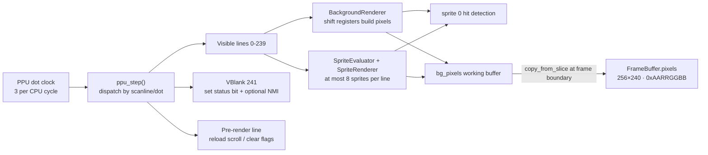

| Component | Key structures | Notes |
| --- | --- | --- |
| `Ppu` | `vram` / `palette` / `oam` / `ctrl` / `mask` / `status` / `v` / `t` / `x` / `w` / `render_v` | Registers and internal latches |
| `BackgroundRenderer` | `BgRenderState` | Dot-by-dot shift-register rendering; the mirroring mode can be switched at runtime |
| `SpriteEvaluator` | `SecondaryOam` | Per-line evaluation (including the 8-sprite overflow bug behavior) |
| `FrameBuffer` | `pixels: Vec<u32>`, `width`, `height` | The externally visible picture; its size derives from the `WIDTH`/`HEIGHT` constants |

**The external picture contract** (hosts must not assume anything else):

```rust
nes_core::WIDTH                     // 256
nes_core::HEIGHT                    // 240
nes_core::PIXEL_FORMAT              // PixelFormat::Argb8888 → "argb8888"
PixelFormat::channel_shifts()       // [red, green, blue, alpha] bit shifts = [16, 8, 0, 24]
```

---

## 7. APU and audio path

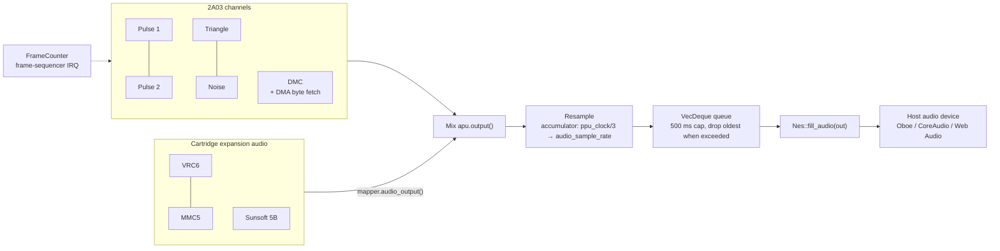

Design points:

- **The host decides the sample rate**: `Config::sample_rate` (48 kHz by default);
  redirect with `Nes::set_sample_rate()` when the device rate changes. Resampling happens
  in the core, and the host does none.
- **Pull-based interface**: `fill_audio(out) -> usize` returns the number of floats written
  (always even, i.e. whole stereo frames). `0` means there is temporarily no data, and less
  than `out.len()` means only part was filled — exactly the behavior a device callback
  needs.
- **Bounded queue**: about 0.5 s of capacity; beyond that the oldest samples are dropped
  (`pop_front`, O(1)). When the host stalls, it is stale audio that is dropped rather than
  memory growing without bound.
- **Audio capture can be turned off**: with `Config::enable_audio = false` the APU still
  runs in CPU time (frame IRQ and DMC DMA affect CPU timing), it just produces no samples.
- Output is **interleaved stereo** with left equal to right (the 2A03 itself is mono).

---

## 8. Mapper abstraction

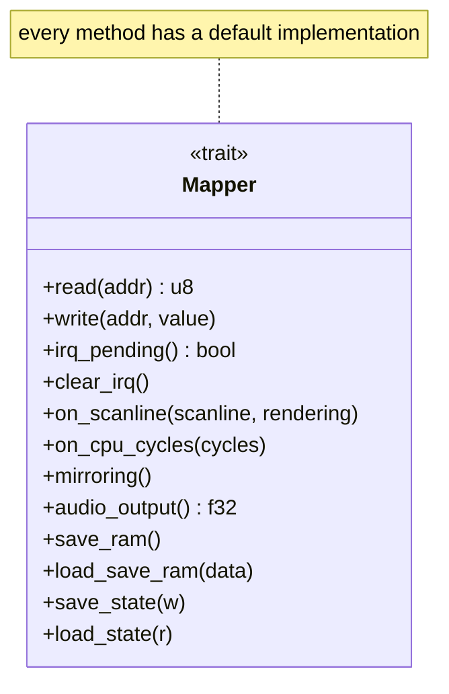

`Mapper: Send + Sync + Debug`, created by the
`create_mapper(number, prg, chr) -> Box<dyn Mapper>` factory; `supported_mappers()` returns
the numbers the core actually supports, which hosts use to reject unsupported cartridges
up front.

| Number | Implementation | Name |
| --- | --- | --- |
| 0 | `mapper0` | NROM |
| 1 | `mapper1` | MMC1 (SxROM) |
| 2 | `mapper2` | UxROM (UNROM/UOROM) |
| 3 | `mapper3` | CNROM |
| 4 | `mapper4` | MMC3 (TxROM) |
| 5 | `mapper5` | MMC5 (ExROM) |
| 7 | `mapper7` | AxROM |
| 9 / 10 | `mapper9` / `mapper10` | MMC2 / MMC4 |
| 11 | `mapper11` | Color Dreams |
| 21 / 22 / 23 / 25 | `mapper21` | VRC4a / VRC2a / VRC4f / VRC4b |
| 24 / 26 | `mapper24` | VRC6a / VRC6b |
| 32 | `mapper32` | Irem G-101 |
| 33 / 48 | `mapper33` | Taito TC0190 (48 adds IRQ) |
| 34 | `mapper34` | BNROM / NINA-001 |
| 38 | `mapper38` | PCI556 |
| 65 | `mapper65` | Irem H3001 |
| 66 | `mapper66` | GxROM |
| 69 | `mapper69` | Sunsoft FME-7 (5B) |
| 71 | `mapper71` | Camerica |
| 74 | `mapper74` | Waixing MMC3 with 2 KB CHR RAM (Metal Max / 机甲战士) |
| 79 | `mapper79` | NINA-003 |
| 94 | `mapper94` | Senjou no Ookami (UNROM variant) |
| 118 / 119 | `mapper118` / `mapper119` | TxSROM / TQROM (MMC3 variants) |
| 140 | `mapper140` | Jaleco JF-11/14 |
| 180 | `mapper180` | UNROM (Crazy Climber variant) |
| 240 / 241 | `mapper240` / `mapper241` | Chinese PCB / BxROM variant |
| 6 | `mapper6` | FFE F4 (Front Fareast) |
| 8 | `mapper8` | FFE F3 (Front Fareast) |
| 16 | `mapper16` | Bandai FCG (the barcode EEPROM is not emulated) |
| 18 | `mapper18` | Jaleco SS88006 |
| 30 | `mapper30` | UNROM 512 |
| 87 | `mapper87` | Jaleco J87 |
| 95 | `mapper95` | Namcot 3425 (the nametable bit is approximated globally) |
| 112 | `mapper112` | Asder |
| 113 | `mapper113` | HES / NTDEC |
| 114 | `mapper114` | Asder / Waixing MMC3 clone |
| 117 | `mapper117` | Future Media |
| 133 | `mapper133` | Sachen 8259 |
| 152 | `mapper152` | Bandai 74161/32 |
| 178 | `mapper178` | Waixing FS004 |
| 206 | `mapper206` | Namcot 118 / Tengen MIMIC-1 (DxROM) |
| 227 | `mapper227` | "1200-in-1" multicarts |
| 244 | `mapper244` | C&E (Decathlon) |

Not implemented, and why:

- **116** (Gouder SOMARI-P) and **176** (8025 multicarts) pick their behaviour — which ASIC
  they simulate, how big the banks are — from NES 2.0 submappers, and this project
  deliberately does not parse NES 2.0: guessing would be a coin flip on real dumps.
- **158** (Tengen 800037) is a RAMBO-1 board with CIRAM A10 wired to CHR A17. RAMBO-1 is a
  mapper in its own right (sixteen registers, its own CHR layout), so it should be added as
  mapper 64 first and 158 derived from it.
- **185**'s defining feature is a CHR window that points at nametable RAM, which needs the
  PPU to ask the cartridge where pattern data comes from — the same hook section 15.1's A12
  work needs, so 185 lands with it.
- **115** (Ka Sheng / Waixing MMC3 clone) adds an extended bank switch at $6000/$6001 on
  top of the MMC3 register pair, plus its own IRQ. It is a bigger job than the other MMC3
  variants and deserves its own pass rather than a rushed one.

**Steps to add a mapper** (current convention):

1. Create `crates/nes-core/src/mapper/mapperN.rs`, implement `Mapper`, and declare the
   mutable state with `mapper_state!`.
2. Register the module in `mapper/mod.rs`, add it to the `create_mapper` match, and add the
   number to `supported_mappers()`.
3. Add behavior tests in `crates/nes-core/tests/mappers.rs`;
   `test_supported_mappers_matches_create_mapper` automatically checks that the list and
   the actual capabilities agree.

---

## 9. Save state

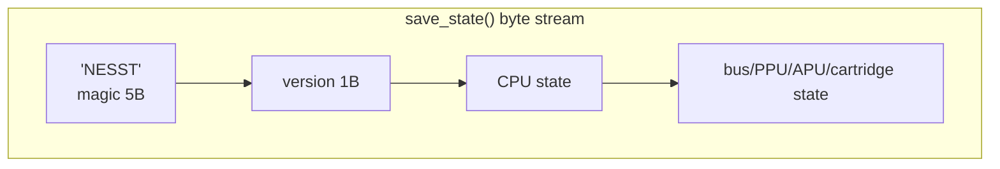

- **No PRG-ROM**: cartridge ROM is large immutable data and is not stored again; a state can
  therefore **only be restored onto the same cartridge**.
- **Encoding**: the `StateField` trait plus generator macros (`state_field_scalar!` /
  `state_field_vec!` / `state_fields!` / `mapper_state!`), little-endian, with no
  third-party dependency and no `serde` involved.
- **Defensive reading**: `load_state` validates magic and version first; invalid or
  wrong-version data is ignored and the machine stays as it was (no panic, no half-applied
  corruption). Out-of-range reads return 0 instead of panicking.
- **Determinism**: sliced execution and whole-frame execution produce byte-identical state
  at the same frame boundary, which is the prerequisite for save/replay correctness.
- **Battery saves** and save states are two independent paths: `save_ram()` /
  `load_save_ram()` only handle the cartridge's battery RAM (`.sav` semantics) and have
  nothing to do with full-machine snapshots.

---

## 10. Host integration contract

### 10.1 Minimal integration sequence

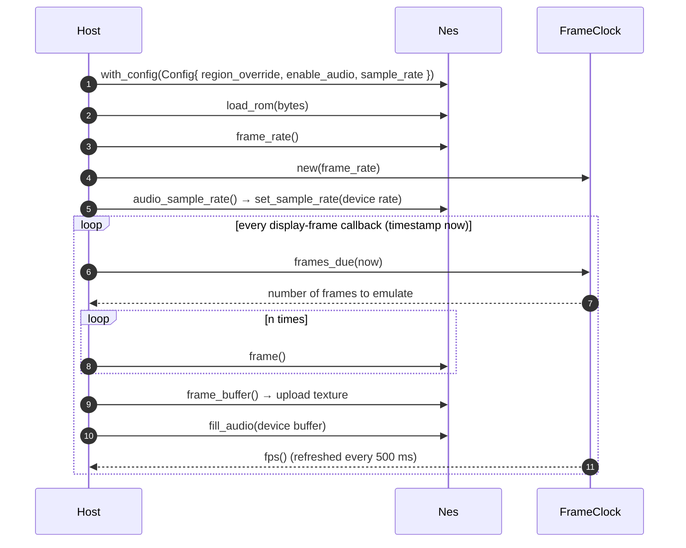

### 10.2 `FrameClock`: the host-agnostic pacing component

It translates "host timestamps" into "a number of whole frames", replacing the rAF
accumulator logic each front end used to write for itself:

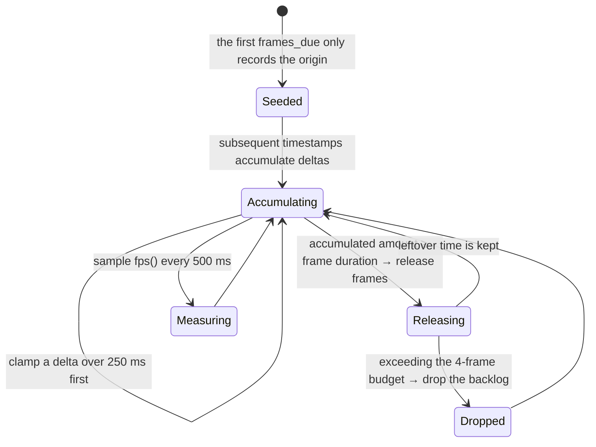

Built-in policy (the catch-up limit can be adjusted with `set_max_catch_up_frames()`; the
rest are the current defaults): catch-up limit 4 frames, single timestamp-interval clamp
250 ms, FPS sampling window 500 ms. `reset()` is for "pause / reset / foreground" — it
keeps paused time from being counted as emulated time. No platform dependency, no
allocation, and `no_std`-compatible.

### 10.3 Video and input contract

- **Video**: `frame_buffer() -> &[u32]` (`0xAARRGGBB`), or `frame_buffer_ptr()` for zero
  copy; size and channel shifts come from the core's constants.
- **Pixel byte order**: `0xAARRGGBB` sits in little-endian memory as `B, G, R, A`, which is
  exactly `MTLPixelFormatBGRA8Unorm` (Metal) and
  `kCGBitmapByteOrder32Little | kCGImageAlphaNoneSkipFirst` (CoreGraphics) — **native front
  ends can upload it directly, with no swizzle**; browsers only need channel reordering
  because `ImageData` is RGBA-ordered.
- **Input**: `set_button(player, BUTTON_*, pressed)`, with `player` 1 or 2; button indices
  follow the `BUTTON_*` constants, which the bindings export under the same names so the
  two sides can't drift apart.
- **Saves**: `save_state()` / `load_state()` (whole machine), `save_ram()` /
  `load_save_ram()` (battery).
- **Diagnostics**: `peek(addr)`, `frame_number()`, `is_frame_ready()`, `mirroring()`,
  `region()`.

### 10.4 Platform-specific notes

| Platform | Frame callback | Audio | Notes |
| --- | --- | --- | --- |
| Web | `requestAnimationFrame` | `AudioWorklet` (falls back to `ScriptProcessorNode`) | Implemented, see section 12 |
| iOS | `CADisplayLink` | `AVAudioEngine` / `AudioUnit` render callback | Bindings are ready (`nes-uniffi`, see §11.2); feed the callback timestamp (seconds → milliseconds) to `FrameClock` |
| Android | `Choreographer` | Oboe (low latency) | The same `nes-uniffi`, using `--language kotlin`; put the emulator on its own thread and let the audio callback do nothing but `fill_audio` |
| macOS / Windows | `CVDisplayLink` / a timer | CoreAudio / WASAPI | Same as iOS/native: timestamps + pull audio |

What all three share: **the core never calls back into the host; the host feeds timestamps
and pulls data.** So adding a platform needs no core changes — just implement those four
channels (time, picture, sound, buttons).

### 10.5 Threading and ownership model

The core **has no threads**: no timers, no background threads, no locks of any kind — the
threading strategy is entirely the host's business. This is not an oversight but a
deliberately drawn boundary, and it comes with two contracts that must be respected (pinned
by compile-time assertions in `crates/nes-core/tests/host_contract.rs`):

| Fact | Meaning |
| --- | --- |
| `Nes: Send` | The **whole machine** can be moved to a dedicated emulation thread, the standard approach for native front ends |
| `Nes: !Sync` | `&Nes` **cannot** be shared with other threads: `Apu` holds a `Box<dyn FnMut + Send>` DMC callback, so it is Send but not Sync; the machine has exactly one owner |
| `fill_audio` allocates nothing and locks nothing | But it needs `&mut Nes`, so it can only be called on the thread that **owns the machine** |

So the standard shape for a native front end (iOS / Android / desktop) is:

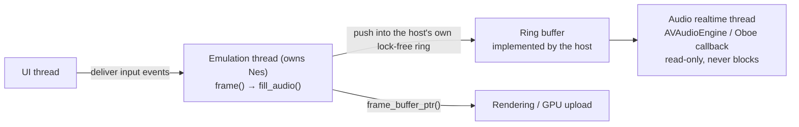

The core needs no changes for multithreading: the host drains audio on the emulation thread
(`fill_audio`) and hands it to its own ring, and the realtime thread only reads the ring and
never touches `Nes`. Conversely, a host may drive emulation directly inside the audio
callback (running `frame()` and taking audio on the same thread), which works too, but then
the frame rate is dragged along by the audio period.

---

## 11. Binding layer: WASM and UniFFI

Both binding crates are pure transport layers: every method forwards 1:1 to the core, with
no emulation logic, and both publish the same contract (frame size, pixel format, mapper
list, frame rate, audio sample rate). So moving from web to native only means changing
syntax.

### 11.1 `nes-wasm` (Web)

`crates/nes-wasm/src/lib.rs` is a pure transport layer whose classes and method names track
the core as closely as possible.

| Category | Exports |
| --- | --- |
| Machine | `new`, `load_rom`, `reset`, `frame`, `run_cycles`, `step_instruction` |
| Video | `get_frame_buffer`, `get_frame_buffer_ptr`, `get_frame_buffer_len` |
| Audio | `fill_audio`, `get_audio_sample_rate`, `set_audio_sample_rate`, `get_buffered_audio_frames`, `clear_audio_samples` |
| Input | `set_button`, `button_down`, `button_up`, `get_button_*` |
| Saves | `save_state`, `load_state`, `get_save_ram`, `set_save_ram`, `has_battery` |
| Contract | `get_frame_width`, `get_frame_height`, `get_pixel_format`, `get_pixel_shifts`, `get_supported_mappers` |
| Pacing | the `FrameClock` class: `frames_due`, `fps`, `frame_rate`, `set_frame_rate`, `reset` |

Constraints:

- The bindings are **generated**; changes must land on the Rust side, followed by
  `cd web && npm run build:wasm`.
- Methods use `snake_case` throughout (matching wasm-bindgen convention), and the TS side
  wraps them as needed.
- The `frame_ready` semantics of `frame()` and `run_cycles()` match the core, with no extra
  interpretation.
- **A panic cannot be caught here** (`wasm32-unknown-unknown` aborts on panic): a bug in the
  core makes `frame()` throw a JS exception and renders the instance unusable, and the host
  must discard and rebuild it — see §15.1. Cartridge-caused failures do not go down this
  path: an undefined opcode hangs the CPU, and `is_cpu_halted()` reports it instead.

### 11.2 `nes-uniffi` (iOS / macOS / Android)

`crates/nes-uniffi/src/lib.rs` is the entry point for native front ends; its interface
corresponds item by item to §11.1, but expressed in UniFFI's idiomatic form:

| Core concept | UniFFI form | Generated into Swift |
| --- | --- | --- |
| `Nes` | Object (holding a `Mutex<CoreNes>`) | `open class Nes`, `Sendable`; `Nes()` / `Nes.withConfig(config:)` |
| `FrameClock` | Object | `FrameClock(frameRate:)` / `FrameClock.forRegion(region:)` |
| `Config` / `Region` | Record / Enum | `struct Config` / `enum Region` |
| `NesError` | Error | `enum NesError: Swift.Error`, switchable over its variants |
| Constants (width/height / pixel format / mapper list) | free functions | `frameWidth()`, `pixelFormat()`, `supportedMappers()`, … |

Three design points worth noting:

- **Handles are reference-counted objects**, their methods take `&self`, and a `Mutex`
  serializes internally. Hosts should still keep the machine on their own emulation thread
  (§10.5); the lock only exists so that calling from another thread by mistake is not UB.
- **A poisoned lock is recovered**: a panic while the lock is held (a bug in the core)
  poisons the `Mutex`, and a plain `unwrap` would permanently ruin the handle over one bad
  frame, so this takes `into_inner()` to stay usable (the host should reload the cartridge).
- **Panics must be caught by the binding layer, and not by relying on UniFFI's default
  behavior alone**: UniFFI does catch panics at the FFI boundary (no UB, and the message is
  preserved), but for **methods that don't return `Result`** the Swift wrapper it generates
  uses `try!` — measured behavior is that a panic becomes a Swift fatal error and the whole
  app crashes (exit code 133, instead of being thrown to the caller). So `nes-uniffi`
  wraps every entry point that executes the CPU (`load_rom` / `reset` / `frame` /
  `run_cycles` / `step_instruction`) in `catch_unwind`, turning them uniformly into
  `throws` on the Swift side, where a panic becomes a catchable
  `NesError::EmulationPanic { message }`. The machine is left mid-instruction and the host
  should reload the cartridge; the handle itself stays usable (a poisoned lock is
  recovered). Note that this only holds while panics unwind: if a host builds with
  `panic = "abort"`, no binding can stop it.

Generating the bindings (the binding files are generated output, not committed):

```text
cargo build -p nes-uniffi
cargo run -p nes-uniffi --bin uniffi-bindgen -- \
    generate --library target/debug/libnes_uniffi.dylib \
    --language swift --out-dir out/swift      # Android uses --language kotlin
```

For device builds, point at the matching artifact (a `.a` for a real iOS device, a `.dylib`
for the simulator).

---

## 12. Web front-end architecture

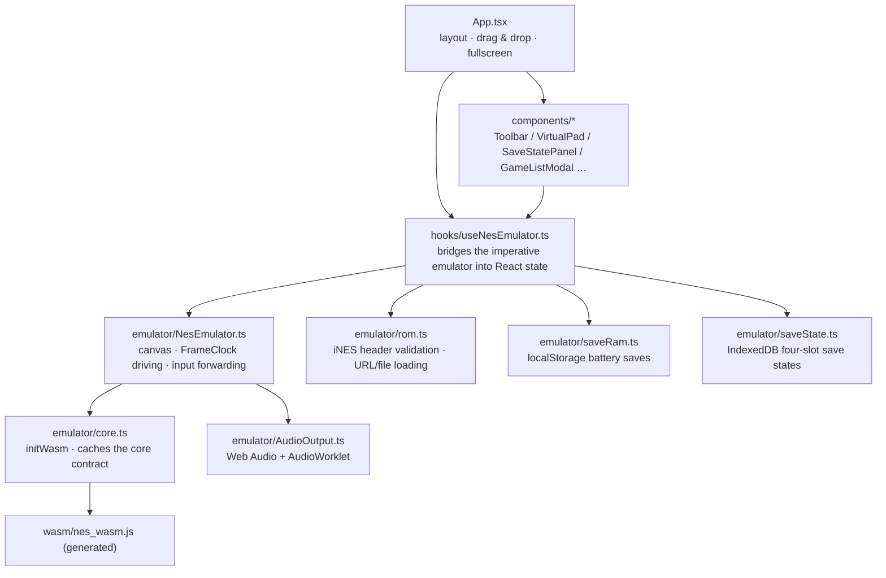

Key points:

- **The emulator instance does not go into React state**: `NesEmulator` lives in a `useRef`
  so re-renders can't interrupt the game loop; React only holds a little UI state (run
  state, FPS, cartridge name, save slots).
- **The core contract is cached once in `core.ts`**: resolution, pixel channel shifts, and
  the mapper list all come from WASM, and the TS side no longer duplicates constants.
- **Audio is pulled at the device rate**: once the `AudioContext` is ready its `sampleRate`
  is handed to the core, and after that whatever `fill_audio` pulls can go straight to the
  worklet for playback.
- **Validation comes first**: before handing anything to WASM, `rom.ts` checks the iNES
  magic, the size, and mapper support, and produces human-readable errors instead of
  letting WASM panic or the screen go black.

---

## 13. Testing strategy

| Suite | Count | Coverage |
| --- | --- | --- |
| `crates/nes-core` unit tests | 564 | Per-module behavior: CPU instructions, PPU timing, APU channels, mappers, saves, pacing, configuration |
| `tests/nestest.rs` | 3 | Authoritative check of the 6502 instruction set and addressing modes |
| `tests/ppu.rs` | 85 (3 ignored) | Background/sprite rendering, scrolling, mirroring, sprite 0, VBlank/NMI |
| `tests/apu.rs` | 64 | Five-channel waveforms, envelopes, length counters, frame sequencer, expansion audio mixing |
| `tests/mappers.rs` | 68 | Bank switching, IRQ, mirroring, battery RAM |
| `tests/host_contract.rs` | 3 | Host contract: the console is `Send` and runs on a worker thread |
| `tests/rom_tests.rs` | 11 | Real test ROMs: blargg's CPU/PPU/APU/MMC3 suites and AccuracyCoin (skipped without ROMs) |
| `crates/nes-uniffi` unit tests | 8 | Binding layer: contract sync, panic containment, audio pull, zero-copy frame reads |
| Doc tests | 1 | `FrameClock` usage example |

### 13.1 Test ROMs: the accuracy baseline

Unit tests say the code does what it was written to do; test ROMs say the *emulation* is
right. `tests/rom_tests.rs` runs the standard suites and is the yardstick every accuracy
change is measured against. ROMs are never committed, so each suite prints a skip note
unless its directory exists under `roms/`:

| Suite | Path under `roms/` | What it pins down |
| --- | --- | --- |
| blargg `instr_test-v5` | `blargg/instr_test-v5/rom_singles/` | Instruction semantics per addressing mode |
| blargg `instr_timing` | `blargg/instr_timing/rom_singles/` | Per-instruction cycle counts, including page crossings |
| blargg `branch_timing_tests` | `blargg/branch_timing_tests/` | Branch taken/not-taken and page-cross cycles |
| blargg `cpu_interrupts_v2` | `blargg/cpu_interrupts_v2/rom_singles/` | IRQ/NMI latency, `CLI` latency, IRQ vs DMA |
| blargg `ppu_vbl_nmi` | `blargg/ppu_vbl_nmi/rom_singles/` | `$2002` VBlank set/clear timing, NMI generation and suppression, odd-frame skip |
| blargg `blargg_ppu_tests` | `blargg/blargg_ppu_tests_2005.09.15b/` | Palette/VRAM/OAM access |
| blargg `oam_read` / `oam_stress` | `blargg/oam_read/`, `blargg/oam_stress/` | OAM addressing quirks, sustained OAM traffic |
| blargg `ppu_open_bus` | `blargg/ppu_open_bus/` | The PPU data bus latch and its decay |
| blargg `sprite_hit_tests` | `blargg/sprite_hit_tests_2005.10.05/` | Sprite 0 hit position and edge cases |
| blargg `sprite_overflow_tests` | `blargg/sprite_overflow_tests/` | Sprite overflow flag, including the hardware bug |
| blargg `mmc3_test_2` | `blargg/mmc3_test_2/rom_singles/` | MMC3 IRQ counter and A12 clocking |
| blargg `apu_test` | `blargg/apu_test/rom_singles/` | Length counters, frame IRQ timing, DMC |
| AccuracyCoin | `accuracycoin/AccuracyCoin.nes` | 146 assorted accuracy tests, results read from RAM |

Sources: blargg's ROMs are mirrored at
<https://github.com/christopherpow/nes-test-roms>, AccuracyCoin at
<https://github.com/100thCoin/AccuracyCoin> (both are freely redistributable test ROMs, but
this repository does not commit them).

The suites use the usual blargg protocol for a result — `$6000` holds `0x80` while the test
runs and the result code afterwards (`0` = passed), with an ASCII report at `$6004` — so a
failure message names the ROM and the exact check that failed. AccuracyCoin is menu-driven:
the harness drives Start to run all tests, then reads the result table it leaves in page
`$0400` (`$FF` = skipped, bit 0 set = passed, otherwise the value is an error code).

Baseline as of 2026-10-14, measured on this checkout:

| Suite | Result |
| --- | --- |
| `instr_test-v5` | 15/16 (only `07-abs_xy`, i.e. `SHX`/`SHY` page-cross corruption) |
| `instr_timing` | 2/2 |
| `branch_timing_tests` | 3/3 |
| `cpu_interrupts_v2` | 0/5 |
| `ppu_vbl_nmi` | 1/10 (only `01-vbl_basics`) |
| `blargg_ppu_tests` | 5/5 |
| `oam_read` | 1/1 |
| `oam_stress` | 1/1 |
| `ppu_open_bus` | 0/1 (the data bus latch does not decay) |
| `sprite_hit_tests` | 11/11 |
| `sprite_overflow_tests` | 5/5 |
| `mmc3_test_2` | 0/6 |
| `apu_test` | 3/8 |
| AccuracyCoin | 146 ran, 78 passed, 0 skipped, 50 failing |

The failures are the roadmap, not a mystery: `mmc3_test_2` needs the A12/PPU-bus hook, the
`ppu_vbl_nmi` and `cpu_interrupts` suites need the VBlank/NMI subtleties and the odd-frame
skip, and the two CPU failures are cycle-count bugs the ROMs localise precisely.

The failing ROMs are listed in `tests/rom_tests.rs` as a per-suite baseline, and that list is
asserted in both directions: a failure outside it is a regression, and an entry that starts
passing fails the suite until it is removed. So `cargo test --workspace` stays green while
the backlog is worked through, and the baseline cannot silently drift.

Conventions:

- ROM-dependent tests are **skipped rather than failed** when `roms/` is missing (CI stays
  green without ROMs).
- **Every fix comes with a regression test**; changes touching execution paths must verify
  the "sliced/single-step == whole-frame" determinism.
- When adding a mapper, use `test_supported_mappers_matches_create_mapper` to keep the list
  from drifting.

---

## 14. Build and CI

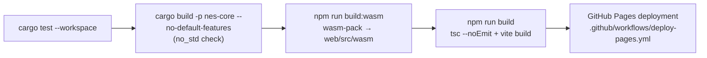

| Command | Purpose |
| --- | --- |
| `cargo test --workspace` | Full test suite (required before committing) |
| `cargo build -p nes-core --no-default-features` | Check the `no_std` path |
| `cargo clippy -p nes-core --all-targets` | Static analysis |
| `cd web && npm run build` | Typecheck + production build |
| `cd web && npm run build:wasm` | Regenerate the WASM bindings (needs `wasm-pack`) |
| `cd web && npm run build:games` | Regenerate the game-list JSON (needs network) |

`web/src/wasm/` and `crates/nes-wasm/pkg/` are generated and not committed, so a fresh
clone needs `npm run build:wasm` before building the front end.

---

## 15. Known limits and technical direction

### 15.1 Emulation accuracy

- **PAL timing model**: the core uniformly assumes "1 CPU cycle = 3 PPU dots", while a real
  PAL machine has a 3.2:1 PPU:CPU ratio. As a result, PAL frame rate, audio, and CPU cycles
  are self-consistent (nothing plays out of tune), but there is still a systematic
  deviation from real hardware timing. Fixing it properly would require a fractional dot
  accumulator, which touches scanline timing and mapper IRQ and is therefore a high-risk
  change.
- **Scanline-level IRQ approximation**: MMC3/MMC5 and friends approximate A12 edges with
  `on_scanline()`, not dot-exact. This is the mainstream trade-off, but a few games that
  depend on exact A12 timing will differ.
- **Resampling quality**: currently sample-and-hold decimation with no anti-aliasing
  filter; going from 1.79 MHz down to 44.1 kHz introduces slight aliasing. The improvement
  direction is second-order/linear interpolation or a half-band filter, done inside
  `fill_audio`.
- **Unsupported mappers**: cartridges outside `supported_mappers()` are rejected outright.
  Section 8 lists what is missing and why (NES 2.0 submapper-driven boards, RAMBO-1, and
  the CHR-from-VRAM window that needs the PPU hook below).
- **An undefined opcode hangs the CPU; it no longer panics**: every one of the 256 opcode
  bytes has a handler in `crates/nes-core/src/cpu/instructions.rs` — the documented
  instructions, the undocumented ones the 2A03 really executes (LAX/SAX/DCP/ISC/SLO/RLA/SRE/
  RRA …), the NOP variants, and the twelve KIL/JAM opcodes. A KIL stops the CPU: it keeps
  burning cycles, frames keep completing, and only an interrupt (NMI, or IRQ with I clear)
  or a reset restarts it, exactly as the hardware does. `Nes::is_cpu_halted()` /
  `is_cpu_halted()` in both bindings reports the hang, and the web front end surfaces it in
  the notification bar (`NesEmulator.reportCpuHalt`).
  - **Why not panic**: it used to be a `panic!`. On `wasm32-unknown-unknown` a panic aborts,
    so `catch_unwind` never returns (measured: what comes back is
    `RuntimeError: unreachable`, and the instance is permanently borrowed, so even `free()`
    throws "attempted to take ownership of Rust value while it was borrowed"). The page
    survived only by throwing the emulator away — a heavy price for a corrupted ROM, and a
    hang is what the hardware does anyway.
  - **The binding boundary stays as a backstop for real bugs**: `nes-uniffi` wraps every
    entry point that runs the CPU in `catch_unwind` and turns a panic into a catchable
    `NesError::EmulationPanic { message }` (§11.2), and the front end's
    `NesEmulator.handleCorePanic` discards the instance and tells the user. Nothing in the
    emulated path is expected to reach either one now.
  - The behavior is pinned by `crates/nes-core/tests/host_contract.rs`, the CPU unit tests
    (`test_kil_halts_the_cpu_without_panicking`, `test_every_opcode_executes`) and the
    binding tests.

### 15.2 Saves and replay

- **State contains no ROM digest**: the host can only identify ownership by "ROM name/URL",
  so a save synced across devices cannot prove it matches. The suggestion is to add a ROM
  fingerprint (e.g. the first few bytes of CRC32/SHA-1) and a cartridge identifier to the
  state header.
- **No rewind / replay API**: determinism is already there, so a ring of snapshots can be
  built above the core; going into the core, it would be best provided as "compressed
  deltas + keyframes".

### 15.3 Performance

- **Single-threaded**: emulation runs on the calling thread; on mobile, put it on its own
  thread and let the audio callback do nothing but `fill_audio`.
- **WASM picture copy**: `get_frame_buffer()` copies about 245 KB per frame and does one
  channel reorder in JS. Optimization directions: use `get_frame_buffer_ptr()` with
  `ImageData`/BGRA construction, or have the core emit an `0xRRGGBBAA`/BGRA variant
  directly.
- **Dynamic mapper dispatch**: every memory access goes through a `dyn Mapper` virtual
  call; for more speed, specialize or inline-cache the hot paths.

### 15.4 Input and peripherals

- Only the standard two-player controller (8 buttons each) is implemented. **Not
  implemented** in the core: turbo, Zapper light gun, Four Score four-player adapter. Turbo
  needs nothing here — the web front end pulses the button itself, see
  [`web/README.md`](../web/README.md).
- No persistence convention for button macros/remapping (remapping is the front end's job).

### 15.5 Front end and output

- No NTSC filter, scanlines, or configurable palette; currently only a fixed 64-color ARGB
  palette.
- No screen recording/screenshot export (a front end can build it on `frame_buffer()`).
- Save slots are fixed at 4 (a front-end convention; the core doesn't care).

### 15.6 Suggested order of work

1. **Add a fingerprint to save states** (low cost, fixes the correctness problem with
   cross-device sync).
2. **Resampling quality** (the change is confined to the audio path, with visible payoff).
3. **Zero-copy WASM picture** (front-end performance, with measurable payoff).
4. **First native front end** (iOS or Android, to prove the section 10 contract really is
   "platform-agnostic").
5. **PAL timing and A12 accuracy** (high risk, high reward; needs PAL test material).

---

## 16. References

- NESdev Wiki: CPU / PPU / APU timing and register semantics <https://www.nesdev.org/wiki/>
- `nestest`: the 6502 instruction set validation log <https://www.nesdev.org/wiki/Emulator_tests>
- iNES header format: <https://www.nesdev.org/wiki/INES>
- This repository's `README.md`: build, run, and front-end usage
