# NES 模拟器技术架构说明

**简体中文** · [English](./architecture.md)

本文说明本仓库的技术架构、核心运行时模型、宿主接入契约，以及后续演进方向。
目标是让新同学能在一小时内建立整体心智模型，也能让准备接入新平台（iOS / Android /
macOS / Windows）的工程师知道"该实现什么、不该实现什么"。

- 适用版本：`main`（截至 2026-10-12）
- 代码规模：Rust 约 3.1 万行（其中 `crates/nes-core/src` 约 2.5 万行）、TypeScript 约 2.8 千行
- 测试规模：810 个测试（全部通过），含 nestest、blargg、AccuracyCoin
  真实 ROM 套件（`roms/` 为空时自动跳过）

---

## 1. 设计目标与原则

整个工程围绕一条主线：**把"NES 到底是什么"和"如何呈现给用户"彻底分开**。

| 原则 | 落地方式 |
| --- | --- |
| 内核零宿主依赖 | `nes-core` 不引用任何平台 API、不引用 `wasm-bindgen`；可在 `no_std` 下编译 |
| 绑定层只做搬运 | `nes-wasm` 的每个方法都是对内核的 1:1 转发，不含业务逻辑 |
| 宿主契约由内核发布 | 分辨率、像素格式、Mapper 列表、帧率、音频采样率都由内核导出，宿主不复制常量 |
| 行为确定性 | 任何驱动粒度（整帧 / 分片 / 单指令）到达同一帧边界后的机器状态逐字节一致 |
| 时间与设备交给宿主 | 内核不含定时器与线程；节奏由 `FrameClock` 统一换算，音频按设备速率拉取 |
| 可移植到任意前端 | 宿主只需实现"喂时间戳 + 拉音频 + 画像素 + 送按键"四件事 |

---

## 2. 分层与仓库结构

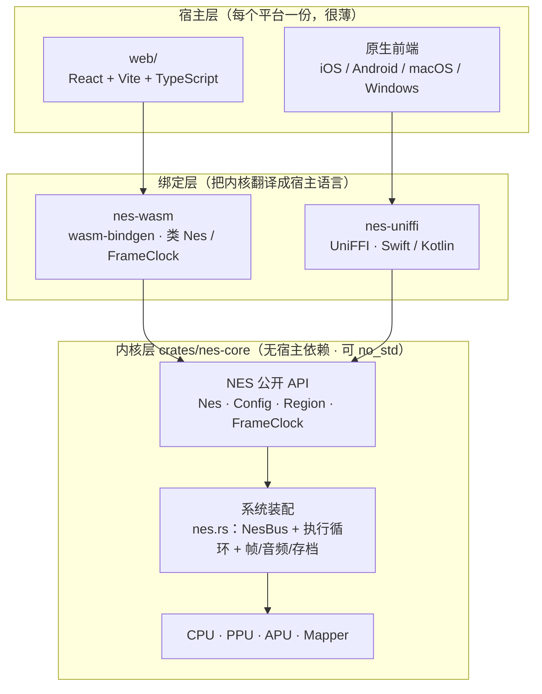

### 目录职责

| 路径 | 职责 | 依赖方向 |
| --- | --- | --- |
| `crates/nes-core/` | 模拟器内核：CPU / PPU / APU / 总线 / Mapper / 存档编码 / 节奏组件 | 运行时只依赖 `bitflags` |
| `crates/nes-wasm/` | `wasm-bindgen` 绑定，`src/lib.rs` 为薄封装 | → `nes-core` |
| `crates/nes-uniffi/` | UniFFI 绑定，供 Swift（iOS/macOS）与 Kotlin（Android）使用 | → `nes-core`、`uniffi` |
| `web/` | React + Vite 前端：Canvas 渲染、Web Audio、存档持久化、控制器 UI | → `web/src/wasm`（生成物） |
| `ios/` | 可运行的最小 iOS 应用：Metal 画面、AVAudioEngine 音频、虚拟手柄；Rust 静态库由 `ios/build-core.sh` 产出 | → `crates/nes-uniffi` |
| `web/src/wasm/`、`crates/nes-wasm/pkg/` | `wasm-pack` 生成物，**不入库**（由 `npm run build:wasm` 重新生成） | — |
| `docs/` | 本文与界面截图 | — |
| `roms/` | 本地测试 ROM，**不入库**；缺失时相关测试自动跳过 | — |

### 内核模块地图

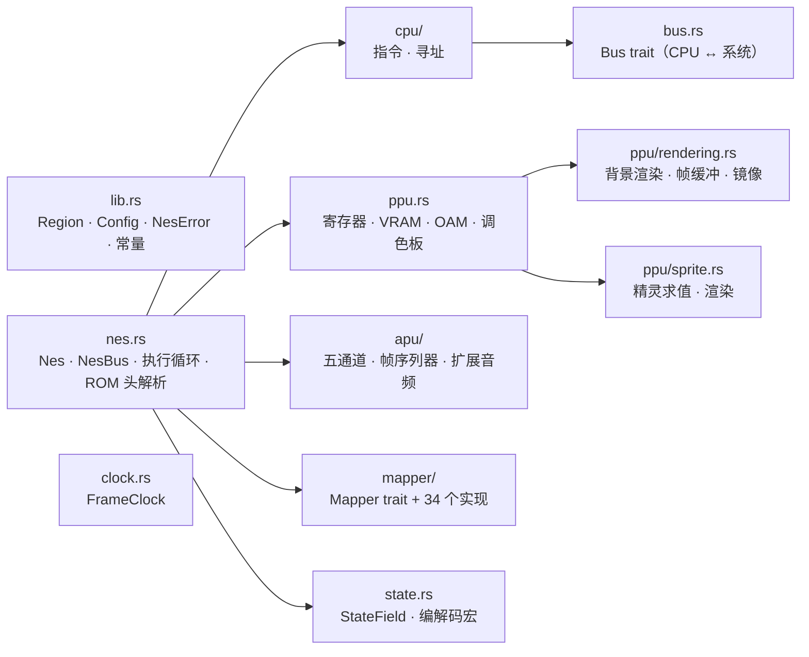

---

## 3. 核心运行时模型

### 3.1 时钟与制式

内核以 **CPU 周期**为最小时间单位，硬性假设 **1 CPU 周期 = 3 个 PPU dot**
（`PPU_DOTS_PER_CPU_CYCLE`，见 `crates/nes-core/src/nes.rs`）。一帧的时长由扫描线数决定，
而不是写死 60 Hz：

| 指标 | NTSC | PAL |
| --- | --- | --- |
| 扫描线 / 帧 | 262 | 312 |
| PPU dot / 扫描线 | 341 | 341 |
| PPU 时钟 | 5,369,318 Hz | 5,320,313 Hz |
| CPU 周期 / 帧 | 29,780 | 35,464 |
| **帧率（内核发布）** | **60.0985 Hz** | **50.0067 Hz** |

帧率由 `Region::fps() = ppu_clock_rate / (341 × 扫描线数)` 推导，宿主通过
`Nes::frame_rate()` 获取，**不要假设 60 Hz**——PAL 卡带是 50.0067 Hz，且 PAL 帧更长。

> **实现细节**：APU 的采样时钟同样取 `ppu_clock_rate / 3`（即机器真正推进 CPU 的速率），
> 而不是卡带标称的 CPU 时钟。PAL 板子的 PPU:CPU 真机比例是 3.2:1，内核按 3:1 建模，
> 因此标称 CPU 时钟与实现不一致；音频若沿用 NTSC 常量会走音约 7.6%。

### 3.2 一帧的执行流程

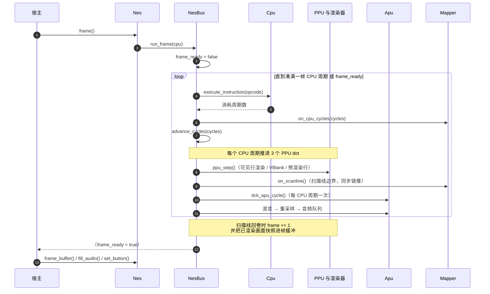

要点：

- **渲染是"边跑边画"的**：背景渲染器持续写入自己的工作缓冲，只有在帧边界才
  `copy_from_slice` 进对外暴露的 `FrameBuffer`。因此帧中途读到的永远是**上一个完整帧**，
  不会撕裂。
- **PPU 写入与渲染解耦**：渲染使用独立的 `ppu.render_v` 滚动计数器，CPU 通过
  `$2006/$2007` 改 `v` 不会破坏正在渲染的帧。
- **整行一次画完，所以"写入与渲染的先后"是一个设置项**：`RenderTiming` 决定第 *N* 行是在
  dot 256 渲染（`ScanlineEnd`，默认：该行更早的写入仍会影响它），还是在 dot 0 渲染
  （`ScanlineStart`）。带光栅效果的游戏各有偏好，因此
  `Config::render_timing` / `Nes::set_render_timing` 是按游戏切换的兼容开关，而不是常量
  （§15.1）。
- **DMA 会让 CPU 停顿**：OAM DMA（`$4014`）停 513/514 周期，DMC 取字节停 4 周期；
  停顿期间 PPU/APU 继续推进。

### 3.3 三种驱动粒度

| API | 语义 | 用途 |
| --- | --- | --- |
| `Nes::frame()` | 跑满一帧（或提前到帧边界） | 常规前端，配合 `FrameClock` |
| `Nes::run_cycles(n)` | 跑至多 n 个 CPU 周期，遇到帧边界提前停；返回实际周期数 | 亚帧调度、音频驱动、精确追帧 |
| `Nes::step_instruction()` | 执行一条指令，返回其周期数 | 调试器、单步回归 |

三者共享同一份单步实现（`NesBus::step_instruction`），因此**分片执行与整帧执行的结果完全一致**
——回归测试会逐字节比对 `save_state()`。`frame_ready` 标志在三者中的语义统一：
`frame()` / `run_cycles()` 进入时清零，执行中置位；`step_instruction()` 不动它，
便于单步跨越帧边界后仍能观察到标志。

---

## 4. 全链路：从 ROM 文件到可玩

前几节讲的是"机器怎么转"，这一节讲**"一个 `.nes` 文件从被选中到能操作角色，中间到底经历了什么"**。
整条链路只做三件事：**校验 → 装卡带并复位 → 让机器以正确节奏一帧一帧地跑**。

### 4.1 全景时序

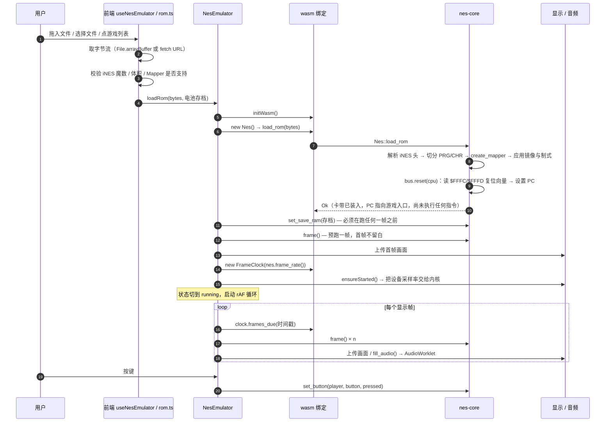

### 4.2 内核侧：装卡带并复位（`Nes::load_rom`）

| 步骤 | 代码位置 | 说明 |
| --- | --- | --- |
| 解析 iNES 头 | `RomHeader::parse` | 魔数 `NES\x1a`；PRG/CHR 大小（16 KB / 8 KB 为单位）；Mapper 号 = flags7 高半字节 + flags6 高半字节；镜像方式；制式（flags9 bit0 / flags10）；电池标志（flags6 bit1）；有 trainer 时跳过 512 字节 |
| 切分 ROM | `NesBus::load_rom` | PRG 必须完整，否则 `InvalidRomFormat`；CHR 长度为 0 表示 CHR-RAM，由 Mapper 自建 |
| 造卡带 | `create_mapper` | 编号未实现时返回 `UnsupportedMapper`（前端在更早一步已拦过，这里是兜底） |
| 应用卡带属性 | `NesBus::load_rom` | 镜像同时写给渲染器与总线；制式优先取 `Config::region_override`，否则用头部声明 |
| 复位 CPU | `Cpu::reset` | `SP -= 3`、置 I 标志、**PC = [$FFFC] \| [$FFFD] << 8**、周期计数清零 |

**关键点：`load_rom` 只负责"装好 + 复位"，不执行任何一条指令。**
函数返回时机器处于"刚按下复位键"的瞬间：PC 已经指向卡带里的游戏入口，但游戏代码一行都还没跑。

### 4.3 复位之后：游戏自己把机器点亮

复位向量指向卡带 PRG 中映射到 `$C000`/`$E000` 的固定 bank（具体哪个 bank 由 Mapper 决定），
游戏代码随后按典型顺序执行：

1. `SEI` / `CLD`：关中断、清十进制标志；
2. 清 2 KB 工作 RAM（约上万周期，常跨越最初几帧）；
3. 等 PPU 稳定（连续读 `$2002` 或轮询 VBlank 标志）；
4. 初始化 PPU：`$2000` 控制寄存器、`$2001` 掩码、`$3F00–$3F1F` 调色板；
5. 初始化 APU：`$4015` 与各通道寄存器；
6. 清 OAM，通常借 `$4014` DMA；
7. 打开 NMI（`$2000` bit7 = 1），进入**每帧由 VBlank 驱动的主循环**：NMI 里更新 OAM、滚动与调色板，
   主循环里跑游戏逻辑并轮询手柄。

所以"可玩"没有某个精确的里程碑事件，它的判据是：
**CPU 进入了由 VBlank / NMI 驱动的每帧循环，画面与声音开始逐帧更新。**
模拟器本身不参与这些判断——它只负责把周期数喂够、把 VBlank 与 NMI 按时送达。

### 4.4 时间线

| 时刻 | 机器状态 | 用户看到 / 听到 |
| --- | --- | --- |
| `load_rom` 返回 | PC 指向复位向量，0 条指令已执行 | 前端尚未渲染，无画面 |
| 预跑第 1 帧（约 29,780 周期，上万条指令） | 清 RAM、初始化 PPU/APU、等第一个 VBlank | 通常仍是黑屏或纯色，取决于游戏 |
| 第 2 帧起 | 游戏进入 NMI 循环，开始绘制标题 / 厂商 logo | 画面开始出现，可能仍无声音 |
| 数十帧内 | 标题画面 + BGM 就绪，开始轮询手柄 | 可操作（例如按 Start 进游戏） |

不同游戏差异很大：有的一帧内就出画，有的会做几秒自检。宿主侧只需要"跑帧 + 显示 + 喂按键"，
不需要为启动过程做任何特例处理。

### 4.5 三层各自负责什么

| 环节 | 前端（web） | 绑定（nes-wasm） | 内核（nes-core） |
| --- | --- | --- | --- |
| 拿到 ROM 字节 | 读文件 / 下载 URL / 游戏列表 | — | — |
| 早期校验 | 魔数、体积、Mapper 支持、人类可读报错 | — | — |
| 解析与装卡带 | — | 转发 `load_rom` | `RomHeader::parse` + `create_mapper` |
| 复位 | — | 转发 | `Cpu::reset`（取复位向量） |
| 电池存档 | 从 localStorage 取，交给 `loadRom` | 转发 `set_save_ram` | 写入卡带 SRAM |
| 节奏 | `FrameClock`（时间戳 → 帧数）、FPS | 转发 | 提供 `frame_rate()` |
| 画面 | 上传 Canvas / 纹理 | 转发缓冲区指针 | 渲染 + 帧缓冲 |
| 声音 | AudioWorklet 播放 | 转发 `fill_audio` | 重采样 + 有界队列 |
| 输入 | 键盘 / 虚拟手柄 / 蓝牙手柄映射 | 转发 `set_button` | 手柄移位寄存器 |
| 持久化 | localStorage / IndexedDB | — | 快照字节流 |

---

## 5. 内存与总线

CPU 通过 `Bus` trait 访问系统；`NesBus` 是唯一实现（`crates/nes-core/src/nes.rs`）。

| 地址范围 | 目标 | 备注 |
| --- | --- | --- |
| `$0000–$1FFF` | CPU 内部 RAM | 2 KB，每 `$0800` 镜像 |
| `$2000–$3FFF` | PPU 寄存器 | `$2000–$2007`，每 8 字节镜像 |
| `$4000–$401F` | APU / I/O | `$4014` OAM DMA、`$4016/$4017` 手柄、APU 通道寄存器 |
| `$4020–$FFFF` | 卡带空间 | 交给 `Mapper`（含 PRG-RAM / 扩展音频 / 寄存器） |

两类工程细节：

- **Open bus**：每次读都会把数据总线锁存到 `open_bus`，非映射地址返回上次的值，
  未插卡带时由它兜底。
- **CHR 读取走卡带**：图案表通过 `Mapper` 读取（`MapperChr`），所以中途换 CHR bank
  立即生效；CHR-RAM 卡带的写入也由 Mapper 承接。

---

## 6. PPU 渲染管线

PPU 负责寄存器语义（`crates/nes-core/src/ppu.rs`）、背景渲染与帧缓冲
（`ppu/rendering.rs`）、精灵求值与渲染（`ppu/sprite.rs`）。

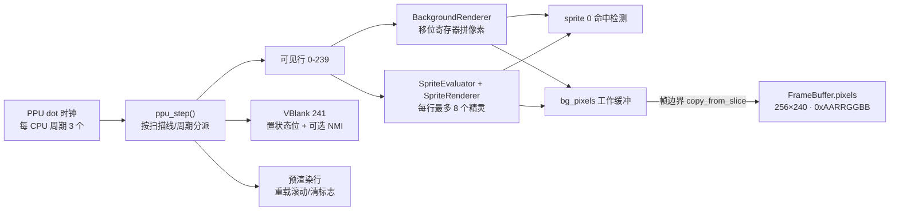

| 组件 | 关键结构 | 说明 |
| --- | --- | --- |
| `Ppu` | `vram` / `palette` / `oam` / `ctrl` / `mask` / `status` / `v` / `t` / `x` / `w` / `render_v` | 寄存器与内部锁存器 |
| `BackgroundRenderer` | `BgRenderState` | 整行渲染：在一个 dot 上从左到右取完瓦片（由 §3.2 的时机设置决定是哪个 dot），因此没有移位寄存器流水线；镜像模式可运行时切换 |
| `SpriteEvaluator` | `SecondaryOam` | 逐行求值（含 8 精灵溢出 bug 行为） |
| `FrameBuffer` | `pixels: Vec<u32>`、`width`、`height` | 对外暴露的画面，尺寸由 `WIDTH`/`HEIGHT` 常量派生 |

**对外画面契约**（宿主不得自行假设）：

```rust
nes_core::WIDTH                     // 256
nes_core::HEIGHT                    // 240
nes_core::PIXEL_FORMAT              // PixelFormat::Argb8888 → "argb8888"
PixelFormat::channel_shifts()       // [red, green, blue, alpha] 位偏移 = [16, 8, 0, 24]
```

---

## 7. APU 与音频链路

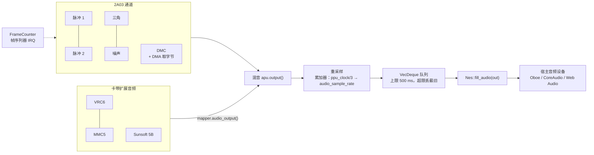

设计要点：

- **采样率由宿主决定**：`Config::sample_rate`（默认 48 kHz）；设备速率变化时用
  `Nes::set_sample_rate()` 重定向。重采样在内核完成，宿主不做任何重采样。
- **拉取式接口**：`fill_audio(out) -> usize` 返回写入的 float 数（总是偶数，即整帧立体声）。
  `0` 表示暂时无数据，小于 `out.len()` 表示只填了一部分——正是设备回调需要的行为。
- **有界队列**：约 0.5 秒容量，超过即丢弃最旧样本（`pop_front`，O(1)）。宿主卡顿时
  丢掉的是陈旧音频，而不是无限积压内存。
- **音频捕获可关闭**：`Config::enable_audio = false` 时 APU 仍按 CPU 时序运行
  （帧 IRQ 与 DMC DMA 会影响 CPU 时序），只是不产出样本。
- 输出为**交错立体声**，左/右相同（2A03 本身是单声道）。

---

## 8. Mapper 抽象

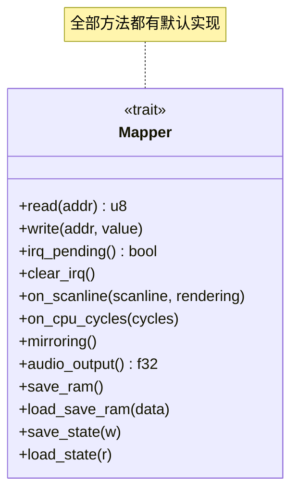

`Mapper: Send + Sync + Debug`，由 `create_mapper(number, prg, chr) -> Box<dyn Mapper>` 工厂创建；
`supported_mappers()` 返回内核实际支持的编号，宿主用它提前拒绝不支持的卡带。

| 编号 | 实现 | 名称 |
| --- | --- | --- |
| 0 | `mapper0` | NROM |
| 1 | `mapper1` | MMC1 (SxROM) |
| 2 | `mapper2` | UxROM (UNROM/UOROM) |
| 3 | `mapper3` | CNROM |
| 4 | `mapper4` | MMC3 (TxROM) |
| 5 | `mapper5` | MMC5 (ExROM) |
| 7 | `mapper7` | AxROM |
| 9 / 10 | `mapper9` / `mapper10` | MMC2 / MMC4 |
| 11 | `mapper11` | Color Dreams |
| 21 / 22 / 23 / 25 | `mapper21` | VRC4a / VRC2a / VRC4f / VRC4b |
| 24 / 26 | `mapper24` | VRC6a / VRC6b |
| 32 | `mapper32` | Irem G-101 |
| 33 / 48 | `mapper33` | Taito TC0190（48 带 IRQ） |
| 34 | `mapper34` | BNROM / NINA-001 |
| 38 | `mapper38` | PCI556 |
| 65 | `mapper65` | Irem H3001 |
| 66 | `mapper66` | GxROM |
| 69 | `mapper69` | Sunsoft FME-7 (5B) |
| 71 | `mapper71` | Camerica |
| 74 | `mapper74` | 外星科技 MMC3 + 2 KB CHR RAM（重装机兵 / 机甲战士） |
| 79 | `mapper79` | NINA-003 |
| 94 | `mapper94` | Senjou no Ookami（UNROM 变体） |
| 118 / 119 | `mapper118` / `mapper119` | TxSROM / TQROM（MMC3 变体） |
| 140 | `mapper140` | Jaleco JF-11/14 |
| 180 | `mapper180` | UNROM（Crazy Climber 变体） |
| 240 / 241 | `mapper240` / `mapper241` | 国产 PCB / BxROM 变体 |
| 6 | `mapper6` | FFE F4（Front Fareast） |
| 8 | `mapper8` | FFE F3（Front Fareast） |
| 16 | `mapper16` | Bandai FCG（条码 EEPROM 未模拟） |
| 18 | `mapper18` | Jaleco SS88006 |
| 30 | `mapper30` | UNROM 512 |
| 87 | `mapper87` | Jaleco J87 |
| 95 | `mapper95` | Namcot 3425（命名表位按全局近似） |
| 112 | `mapper112` | Asder |
| 113 | `mapper113` | HES / NTDEC |
| 114 | `mapper114` | Asder / Waixing MMC3 克隆 |
| 117 | `mapper117` | Future Media |
| 133 | `mapper133` | Sachen 8259 |
| 152 | `mapper152` | Bandai 74161/32 |
| 178 | `mapper178` | Waixing FS004 |
| 206 | `mapper206` | Namcot 118 / Tengen MIMIC-1（DxROM） |
| 227 | `mapper227` | "1200-in-1" 多合一卡带 |
| 244 | `mapper244` | C&E（Decathlon） |

未实现及原因：

- **116**（Gouder SOMARI-P）与 **176**（8025 多合一）靠 NES 2.0 submapper 决定行为——模拟哪种
  ASIC、银行多大——而本项目明确不解析 NES 2.0：猜 submapper 等于在真实 dump 上抛硬币。
- **158**（Tengen 800037）是 RAMBO-1 板卡，CIRAM A10 接在 CHR A17 上。RAMBO-1 本身就是一个
  独立 Mapper（16 个寄存器、自己的 CHR 布局），值得先补 mapper 64，再由它派生 158。
- **185** 的核心特性是"CHR 窗口指向命名表 RAM"，需要 PPU 向卡带询问图案数据来源。这个钩子
  与 §15.1 中 A12 的工作是同一个，因此 185 与它一起落地。
- **115**（Ka Sheng / Waixing 的 MMC3 克隆）在 MMC3 寄存器对之外还有 $6000/$6001 的扩展
  银行切换和自己的 IRQ，工作量明显大于其它 MMC3 变体，值得单独一轮认真做。

**新增一个 Mapper 的步骤**（当前约定）：

1. 新建 `crates/nes-core/src/mapper/mapperN.rs`，实现 `Mapper`，用 `mapper_state!` 声明可变状态。
2. 在 `mapper/mod.rs` 注册模块、加入 `create_mapper` 的 match、并把编号加入 `supported_mappers()`。
3. 在 `crates/nes-core/tests/mappers.rs` 增加行为测试；
   `test_supported_mappers_matches_create_mapper` 会自动校验"名单与实际能力"一致。

---

## 9. 存档（Save State）

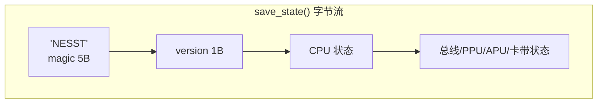

- **不含 PRG-ROM**：卡带 ROM 是不可变的大块数据，不重复存储；因此状态**只能恢复到同一卡带**。
- **编码方式**：`StateField` trait + 生成器宏（`state_field_scalar!` / `state_field_vec!` /
  `state_fields!` / `mapper_state!`），小端、无第三方依赖、无 `serde` 参与。
- **防御式读取**：`load_state` 先校验 magic 与版本；非法/异版本数据被忽略，机器保持原状
  （不会 panic、不会半途污染）。读取越界返回 0 而不是 panic。
- **确定性**：分片执行与整帧执行到达同一帧边界时状态逐字节一致，这是存档/回放正确性的前提。
- **电池存档**与即时存档是两条独立链路：`save_ram()` / `load_save_ram()` 只处理卡带上的
  电池 RAM（`.sav` 语义），与整机快照无关。

---

## 10. 宿主接入契约

### 10.1 最小接入序列

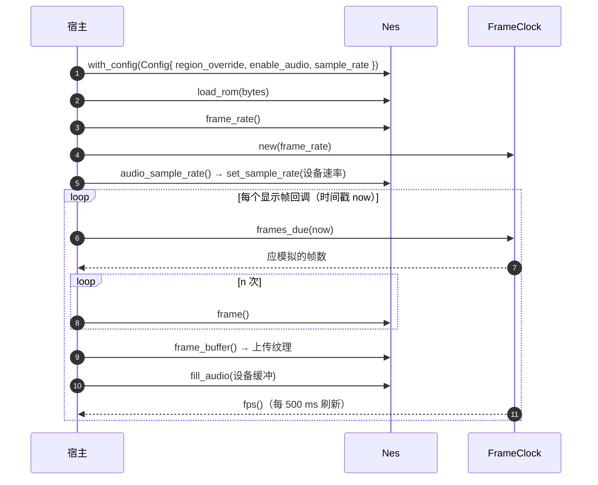

### 10.2 `FrameClock`：宿主无关的节奏组件

它把"宿主的时间戳"翻译成"整帧数量"，取代了每个前端各写一遍的 rAF 累加器逻辑：

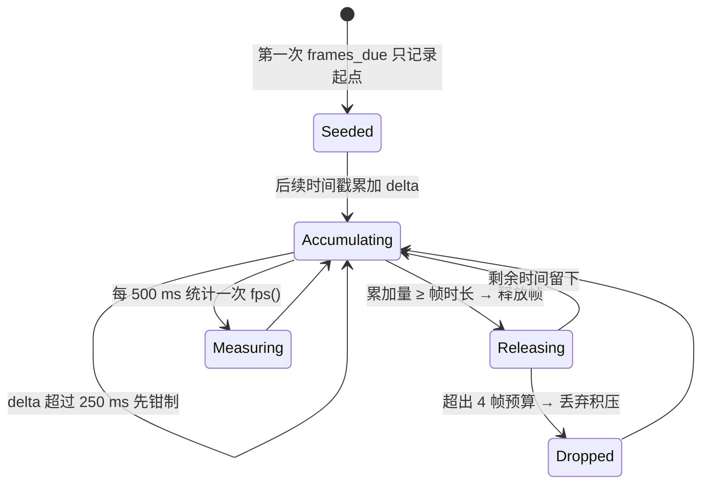

内置策略（追帧上限可用 `set_max_catch_up_frames()` 调整，其余为当前默认值）：
追帧上限 4 帧、单次时间戳间隔钳制 250 ms、FPS 采样窗口 500 ms。`reset()` 用于
"暂停 / 复位 / 切前台"——避免把暂停时长当成模拟时间。无平台依赖、不分配内存，`no_std` 可用。

### 10.3 视频与输入契约

- **视频**：`frame_buffer() -> &[u32]`（`0xAARRGGBB`），或 `frame_buffer_ptr()` 做零拷贝；
  尺寸与通道偏移从内核常量取。
- **像素字节序**：`0xAARRGGBB` 在小端内存里的字节序是 `B, G, R, A`，正好等于
  `MTLPixelFormatBGRA8Unorm`（Metal）与
  `kCGBitmapByteOrder32Little | kCGImageAlphaNoneSkipFirst`（CoreGraphics）——
  **原生前端可以直接上传，不需要 swizzle**；浏览器需要做通道重排，只是因为
  `ImageData` 是 RGBA 序。
- **输入**：`set_button(player, BUTTON_*, pressed)`，`player` 为 1/2；按键索引以 `BUTTON_*` 常量
  为准，绑定层也导出同名常量，避免两侧漂移。
- **存档**：`save_state()` / `load_state()`（整机）、`save_ram()` / `load_save_ram()`（电池）。
- **诊断**：`peek(addr)`、`frame_number()`、`is_frame_ready()`、`mirroring()`、`region()`。

### 10.4 各平台落地建议

| 平台 | 帧回调 | 音频 | 备注 |
| --- | --- | --- | --- |
| Web | `requestAnimationFrame` | `AudioWorklet`（回退 `ScriptProcessorNode`） | 已实现，见第 12 节 |
| iOS | `CADisplayLink` | `AVAudioEngine` / `AudioUnit` 渲染回调 | 绑定已就绪（`nes-uniffi`，见 §11.2）；把回调时间戳（秒→毫秒）喂给 `FrameClock` |
| Android | `Choreographer` | Oboe（低延迟） | 同一份 `nes-uniffi`，换 `--language kotlin`；建议模拟器放独立线程，音频回调只做 `fill_audio` |
| macOS / Windows | `CVDisplayLink` / 定时器 | CoreAudio / WASAPI | 与 iOS/Native 一致：时间戳 + 拉音频 |

三者共同点：**内核不主动回调宿主，宿主主动喂时间戳并拉数据**。因此新增平台不需要改内核，
只需实现这四条通道（时间、画面、声音、按键）。

### 10.5 线程与所有权模型

内核**不带线程**：没有定时器、没有后台线程、没有任何锁——线程策略完全留给宿主。
这不是疏忽，而是刻意划出的边界，因此有两条必须遵守的契约（由
`crates/nes-core/tests/host_contract.rs` 编译期断言钉住）：

| 事实 | 含义 |
| --- | --- |
| `Nes: Send` | 可以把**整台机器**搬到专用模拟线程，这是原生前端的标准做法 |
| `Nes: !Sync` | **不能**把 `&Nes` 共享给其他线程：`Apu` 里存着 `Box<dyn FnMut + Send>` 的 DMC 回调，只 Send 不 Sync；机器只有一个所有者 |
| `fill_audio` 无分配、无锁 | 但它需要 `&mut Nes`，所以只能在**拥有机器的那条线程**上调用 |

于是原生前端（iOS / Android / 桌面）的标准形态是：

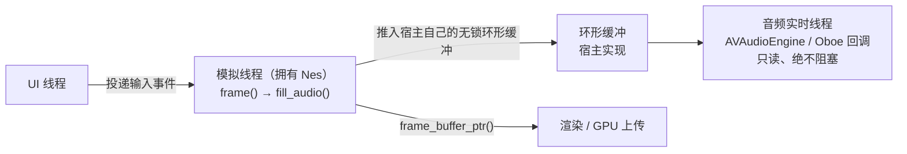

内核无需为多线程做任何改动：宿主在模拟线程把音频抽干（`fill_audio`）后交给自己的环，
实时线程只读环、永不碰 `Nes`。反过来，如果宿主直接在音频回调里驱动模拟（同一线程跑
`frame()` 再取音频），也可以，但那样帧率会被音频周期牵着走。

---

## 11. 绑定层：WASM 与 UniFFI

两个绑定 crate 都是纯搬运层：每个方法都 1:1 转发到内核，不含任何模拟逻辑，
对外发布的是同一套契约（帧尺寸、像素格式、Mapper 列表、帧率、音频采样率），
因此从 Web 迁到原生只需要换语法。

### 11.1 `nes-wasm`（Web）

`crates/nes-wasm/src/lib.rs` 是纯搬运层，类与方法命名尽量与内核一致。

| 类别 | 导出 |
| --- | --- |
| 机器 | `new`、`load_rom`、`reset`、`frame`、`run_cycles`、`step_instruction` |
| 视频 | `get_frame_buffer`、`get_frame_buffer_ptr`、`get_frame_buffer_len` |
| 音频 | `fill_audio`、`get_audio_sample_rate`、`set_audio_sample_rate`、`get_buffered_audio_frames`、`clear_audio_samples` |
| 输入 | `set_button`、`button_down`、`button_up`、`get_button_*` |
| 存档 | `save_state`、`load_state`、`get_save_ram`、`set_save_ram`、`has_battery` |
| 契约 | `get_frame_width`、`get_frame_height`、`get_pixel_format`、`get_pixel_shifts`、`get_supported_mappers` |
| 节奏 | `FrameClock` 类：`frames_due`、`fps`、`frame_rate`、`set_frame_rate`、`reset` |

约束：

- 绑定是**生成物**，修改必须落在 Rust 侧，然后 `cd web && npm run build:wasm`。
- 方法一律使用 `snake_case`（与 wasm-bindgen 惯例一致），TS 侧按需包装。
- `frame()` 与 `run_cycles()` 的 `frame_ready` 语义与内核一致，不做额外解释。
- **panic 在这里无法被 Rust 捕获**（`wasm32-unknown-unknown` panic 即 abort）：内核自身的
  bug 会让 `frame()` 抛出 JS 异常并使实例报废，宿主必须丢弃重建——详见 §15.1。
  卡带引起的问题不走这条路：未定义 opcode 会让 CPU 停机，由 `is_cpu_halted()` 报告。

### 11.2 `nes-uniffi`（iOS / macOS / Android）

`crates/nes-uniffi/src/lib.rs` 是原生前端的入口，接口与 §11.1 逐条对应，
但用 UniFFI 的惯用形态表达：

| 内核概念 | UniFFI 形态 | 生成到 Swift |
| --- | --- | --- |
| `Nes` | Object（内部 `Mutex<CoreNes>`） | `open class Nes`，`Sendable`；`Nes()` / `Nes.withConfig(config:)` |
| `FrameClock` | Object | `FrameClock(frameRate:)` / `FrameClock.forRegion(region:)` |
| `Config` / `Region` | Record / Enum | `struct Config` / `enum Region` |
| `NesError` | Error | `enum NesError: Swift.Error`，可 `switch` 到具体变体 |
| 常量（宽高 / 像素格式 / Mapper 列表） | 自由函数 | `frameWidth()`、`pixelFormat()`、`supportedMappers()` … |

三处需要留意的设计：

- **句柄是引用计数的对象**，方法都取 `&self`，内部用 `Mutex` 串行化。宿主仍应把机器放在
  自己的模拟线程上（§10.5）；锁只是为了"从别的线程误调"不会变成 UB。
- **锁的中毒会被恢复**：持锁期间发生 panic（内核自身的 bug）会毒化 `Mutex`，若直接
  `unwrap` 会让一次坏帧永久废掉句柄，因此这里取 `into_inner()` 继续可用（宿主应重新加载卡带）。
- **panic 必须由绑定层兜住，而且不能只靠 UniFFI 的默认行为**：UniFFI 确实会在 FFI 边界捕获
  panic（不会 UB，消息也保留），但对**不返回 `Result` 的方法**，它生成的 Swift 包装是 `try!`——
  实测结果是 panic 变成 Swift 致命错误、整个 App 崩溃（退出码 133，而不是抛给调用方）。
  因此 `nes-uniffi` 自己用 `catch_unwind` 包住所有会执行 CPU 的入口
  （`load_rom` / `reset` / `frame` / `run_cycles` / `step_instruction`），把它们统一变成
  Swift 侧的 `throws`，panic 变为可捕获的 `NesError::EmulationPanic { message }`。
  机器此时停在半条指令上，宿主应重新加载卡带——句柄本身仍然可用（锁中毒会被恢复）。
  注意这条只在 panic 展开（unwind）时成立：若宿主用 `panic = "abort"` 构建，任何绑定都拦不住。

生成绑定（绑定文件是生成物，不入库）：

```text
cargo build -p nes-uniffi
cargo run -p nes-uniffi --bin uniffi-bindgen -- \
    generate --library target/debug/libnes_uniffi.dylib \
    --language swift --out-dir out/swift      # Android 用 --language kotlin
```

设备构建请指向对应的产物（iOS 真机是 `.a`，模拟器是 `.dylib`）。

---

## 12. Web 前端架构

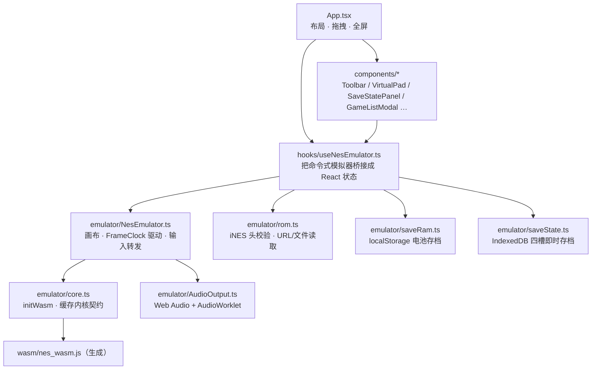

要点：

- **模拟器实例不进 React 状态**：`NesEmulator` 存在 `useRef` 中，避免重渲染打断游戏循环；
  React 只持有少量 UI 状态（运行态、FPS、卡带名、存档槽）。
- **内核契约在 `core.ts` 缓存一次**：分辨率、像素通道偏移、Mapper 列表都来自 WASM，
  TS 侧不再复制常量。
- **音频按设备速率取数**：`AudioContext` 就绪后把 `sampleRate` 交给内核，
  之后 `fill_audio` 拉到的数据可直接交给 worklet 播放。
- **校验前置**：`rom.ts` 在交给 WASM 之前校验 iNES 魔数、体积、Mapper 支持情况，
  给出人类可读的错误，而不是让 WASM panic 或黑屏。

---

## 13. 测试策略

| 套件 | 数量 | 覆盖内容 |
| --- | --- | --- |
| `crates/nes-core` 单元测试 | 567 | 各模块行为：CPU 指令、PPU 时序、APU 通道、Mapper、存档、节奏、配置 |
| `tests/nestest.rs` | 3 | 6502 指令集与寻址模式的权威校验 |
| `tests/ppu.rs` | 83 | 背景/精灵渲染、滚动、镜像、sprite 0、VBlank/NMI、卡带命名表 |
| `tests/apu.rs` | 64 | 五通道波形、包络、长度计数、帧序列器、扩展音频混音 |
| `tests/mappers.rs` | 68 | 银行切换、IRQ、镜像、电池 RAM |
| `tests/host_contract.rs` | 3 | 宿主契约：控制台是 `Send`，可在工作线程上运行 |
| `tests/rom_tests.rs` | 14 | 真实测试 ROM：blargg 的 CPU/PPU/APU/MMC3 套件与 AccuracyCoin（无 ROM 时跳过） |
| `crates/nes-uniffi` 单元测试 | 8 | 绑定层：契约同步、panic 兜底、音频拉取、零拷贝读帧 |
| 文档测试 | 1 | `FrameClock` 用法示例 |

### 13.1 测试 ROM：精度基线

单元测试只能说明代码按写法在跑，测试 ROM 才能说明**模拟得对不对**。
`tests/rom_tests.rs` 跑的是业界标准套件，也是此后每一处精度改动的衡量基准。
ROM 不入库，所以只要 `roms/` 下没有对应目录，套件就打一行 skip 说明：

| 套件 | `roms/` 下的路径 | 钉住的东西 |
| --- | --- | --- |
| blargg `instr_test-v5` | `blargg/instr_test-v5/rom_singles/` | 各寻址模式的指令语义 |
| blargg `instr_timing` | `blargg/instr_timing/rom_singles/` | 逐指令周期数，含跨页 |
| blargg `branch_timing_tests` | `blargg/branch_timing_tests/` | 分支命中/未命中与跨页周期 |
| blargg `cpu_interrupts_v2` | `blargg/cpu_interrupts_v2/rom_singles/` | IRQ/NMI 延迟、`CLI` 延迟、IRQ 与 DMA 的相互影响 |
| blargg `ppu_vbl_nmi` | `blargg/ppu_vbl_nmi/rom_singles/` | `$2002` VBlank 置位/清除时序、NMI 生成与抑制、奇数帧跳点 |
| blargg `blargg_ppu_tests` | `blargg/blargg_ppu_tests_2005.09.15b/` | 调色板/VRAM/OAM 访问 |
| blargg `oam_read` / `oam_stress` | `blargg/oam_read/`、`blargg/oam_stress/` | OAM 寻址细节、持续 OAM 写入 |
| blargg `ppu_open_bus` | `blargg/ppu_open_bus/` | PPU 数据总线锁存与衰减 |
| blargg `sprite_hit_tests` | `blargg/sprite_hit_tests_2005.10.05/` | sprite 0 命中位置与边界情形 |
| blargg `sprite_overflow_tests` | `blargg/sprite_overflow_tests/` | sprite 溢出标志，含硬件 bug 行为 |
| blargg `mmc3_test_2` | `blargg/mmc3_test_2/rom_singles/` | MMC3 IRQ 计数器与 A12 计数 |
| blargg `apu_test` | `blargg/apu_test/rom_singles/` | 长度计数器、帧 IRQ 时序、DMC |
| AccuracyCoin | `accuracycoin/AccuracyCoin.nes` | 146 项综合精度测试，结果从 RAM 读取 |

来源：blargg 的 ROM 镜像在 <https://github.com/christopherpow/nes-test-roms>，
AccuracyCoin 在 <https://github.com/100thCoin/AccuracyCoin>（两者都可自由分发，但本仓库不入库）。

套件用 blargg 的通用协议上报结果：测试进行中 `$6000` 为 `0x80`，结束后写入结果码
（`0` 为通过），`$6004` 起是 ASCII 报告——所以失败信息里能直接看到是哪个 ROM、
哪一项检查失败。AccuracyCoin 是菜单式 ROM：harness 会按 Start 跑完全部测试，
再读它留在 `$0400` 页的结果表（`$FF` = 跳过，bit0 置位 = 通过，否则该值就是错误码）。

2026-10-14 在本机的基线：

| 套件 | 结果 |
| --- | --- |
| `instr_test-v5` | 16/16 |
| `instr_timing` | 2/2 |
| `branch_timing_tests` | 3/3 |
| `cpu_interrupts_v2` | 0/5 |
| `ppu_vbl_nmi` | 4/10 |
| `blargg_ppu_tests` | 5/5 |
| `oam_read` | 1/1 |
| `oam_stress` | 1/1 |
| `ppu_open_bus` | 0/1（数据总线锁存不会衰减） |
| `sprite_hit_tests` | 11/11 |
| `sprite_overflow_tests` | 5/5 |
| `mmc3_test_2` | 4/6（A12 滤波与"alternate" IRQ 版本仍为近似） |
| `apu_test` | 3/8 |
| AccuracyCoin | 78 通过、0 跳过、50 失败（ROM 自己的计数器取决于结果页停留多久，harness 只用它做存活检查） |

这些失败不是谜团，就是路线图：`mmc3_test_2` 需要 A12/PPU 总线钩子，
`ppu_vbl_nmi` 与 `cpu_interrupts` 需要 VBlank/NMI 细节与奇数帧跳点，
两处 CPU 失败则是 ROM 已经精确定位到具体指令的周期计数 bug。

失败的 ROM 以"每个套件一份基线清单"的形式写在 `tests/rom_tests.rs` 里，并且双向断言：
清单之外的失败视为回归，清单内变成通过的项会直接让测试失败，直到把它从清单删掉。
这样在消化欠账的过程中 `cargo test --workspace` 仍能保持绿色，基线也不会悄悄漂移。

约定：

- 依赖 ROM 的测试在 `roms/` 缺失时**跳过而非失败**（CI 无 ROM 也能全绿）。
- **每个修复都要带回归测试**；涉及执行路径的改动要验证"分片/单步 == 整帧"的确定性。
- 新增 Mapper 时用 `test_supported_mappers_matches_create_mapper` 保证名单不漂移。

---

## 14. 构建与 CI

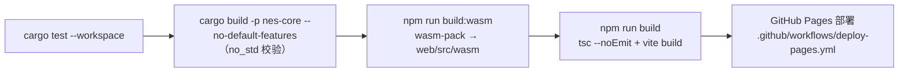

| 命令 | 用途 |
| --- | --- |
| `cargo test --workspace` | 全量测试（提交前必跑） |
| `cargo build -p nes-core --no-default-features` | 校验 `no_std` 路径 |
| `cargo clippy -p nes-core --all-targets` | 静态检查 |
| `cd web && npm run build` | 类型检查 + 生产构建 |
| `cd web && npm run build:wasm` | 重新生成 WASM 绑定（需要 `wasm-pack`） |
| `cd web && npm run build:games` | 重新生成游戏列表 JSON（需要网络） |

`web/src/wasm/` 与 `crates/nes-wasm/pkg/` 是生成物且不入库，克隆后需先跑 `npm run build:wasm`。

---

## 15. 已知边界与技术方向

### 15.1 模拟精度

- **PAL 时序建模**：内核统一按"1 CPU 周期 = 3 PPU dot"，而真机 PAL 的 PPU:CPU 是 3.2:1。
  结果：PAL 的帧率/音频/CPU 周期三者自洽（不会走音），但与真机时序仍有系统性偏差。
  彻底解决需要引入分数 dot 累加器，会影响扫描线时序与 Mapper IRQ，属高风险改动。
- **A12 时序是"推导"出来的**：`Mapper::on_ppu_bus` 在每个 dot 把 PPU 将要驱动的地址交给
  卡带；因为渲染器是整行渲染，这个地址由 dot 时钟反推。MMC3 的 IRQ 计数器现在按硬件规则
  走（上升沿需 A12 保持低 3 个 CPU 周期才计数，重载标志来自 `$C001`），足以通过 blargg
  六个 MMC3 测试中的四个。仍为近似的部分：一帧中首个上升沿落在哪个 dot
  （`4-scanline_timing`）、需要 mapper 4 submapper 4 的 NEC"alternate"IRQ 版本
  （`6-MMC3_alt`）、以及 8x16 精灵下具体哪次取址会抬高 A12 的细节。
- **MMC5 的 ExRAM 已接通，扩展属性与分屏没有**：`$5105` 的命名表映射通过
  `nametable_read`/`nametable_write` 抵达渲染器，因此 ExRAM 命名表与 fill 模式可用。
  扩展属性模式（`$5104` = 3）需要单独解析它自己的字节布局；竖向分屏按决定不做（§15.6）。
- **光栅效果目前是"兼容开关"而不是"修好"**：因为整行一次画完（§3.2），第 *N* 行期间的写入
  要么影响第 *N* 行、要么影响第 *N+1* 行，由 `RenderTiming` 决定。这是给"分屏高/低一行"
  的游戏准备的旋钮；要让这个选择变得不必要，就得改成按 dot 渲染，那与 §6 的管线改造是
  同一件事，目前还不在清单里。
- **VBlank 标志周边已经接近但不精确**：奇数帧跳点、`$2002` 读竞争（在标志置位那一 dot 读取会
  同时抹掉该帧的标志与 NMI）、以及"VBlank 期间写 $2000 打开 NMI 立即触发"都已实现——
  blargg 的 `ppu_vbl_nmi` 因此从 1/10 升到 4/10。仍缺：立即触发时 CPU 要**延后一条指令**
  才响应 NMI、抑制窗口的 dot 级精度、以及奇数帧跳点判定所依据的确切 dot。
- **重采样质量**：当前为采样保持式抽取，没有抗混叠滤波；从 1.79 MHz 降到 44.1 kHz
  会有轻微混叠。改进方向是二阶/线性插值或半带滤波，并在 `fill_audio` 内部完成。
- **未支持的 Mapper**：`supported_mappers()` 之外的卡带会被明确拒绝。缺哪些、为什么，
  见第 8 节（依赖 NES 2.0 submapper 的板卡、RAMBO-1、以及需要 PPU 钩子的 CHR-取-自-VRAM 窗口）。
- **未定义 opcode 让 CPU 停机，不再 panic**：256 个 opcode 字节全部有实现
  （`crates/nes-core/src/cpu/instructions.rs`）——文档化指令、2A03 实际会执行的未文档
  指令（LAX/SAX/DCP/ISC/SLO/RLA/SRE/RRA 等）、NOP 变体，以及 12 个 KIL/JAM。
  KIL 会让 CPU 停机：继续消耗周期、帧照常完成，只有中断（NMI，或 I 位为 0 时的 IRQ）
  或复位能重新启动它，与硬件行为一致。`Nes::is_cpu_halted()` / 两个绑定层的
  `is_cpu_halted()` 用于上报这次停机，Web 前端在通知条里提示用户
  （`NesEmulator.reportCpuHalt`）。
  - **为什么不再 panic**：以前这里是 `panic!`。在 `wasm32-unknown-unknown` 上 panic 即 abort，
    `catch_unwind` 永远不会返回（实测：拿到的是 `RuntimeError: unreachable`，而且实例被永久
    借用、连 `free()` 都会抛 "attempted to take ownership of Rust value while it was borrowed"）。
    页面只能靠丢弃整个模拟器实例存活——为一个损坏的 ROM 付这个代价太重，而硬件本身也只是停机。
  - **绑定边界保留为真正 bug 的兜底**：`nes-uniffi` 仍用 `catch_unwind` 包住所有会执行 CPU 的
    入口，把 panic 变成可捕获的 `NesError::EmulationPanic { message }`（§11.2）；
    前端的 `NesEmulator.handleCorePanic` 会丢弃实例并提示用户。模拟路径上不应再触发这两处。
  - 行为由 `crates/nes-core/tests/host_contract.rs`、CPU 单测
    （`test_kil_halts_the_cpu_without_panicking`、`test_every_opcode_executes`）与绑定层单测钉住。

### 15.2 存档与回放

- 状态**不含 ROM 摘要**：宿主只能按"ROM 名/URL"识别归属，跨设备同步存档时无法自证匹配。
  建议在状态头加入 ROM 指纹（如 CRC32/SHA-1 前若干字节）与卡带标识。
- **无 rewind / 回放 API**：确定性已经具备，可以在上层实现环形快照缓冲；
  若要进内核，建议以"压缩增量 + 关键帧"的形式提供。

### 15.3 性能

- **单线程**：模拟在调用线程上执行；移动端建议放独立线程，音频回调只做 `fill_audio`。
- **WASM 画面拷贝**：`get_frame_buffer()` 每帧复制约 245 KB 并在 JS 里做一次通道重排。
  优化方向：用 `get_frame_buffer_ptr()` + `ImageData`/BGRA 直接构造，或让内核直接输出
  `0xRRGGBBAA`/BGRA 变体。
- **Mapper 动态分发**：每次内存访问都走 `dyn Mapper` 虚调用；如需再提速，可在热路径上
  做特化或内联缓存。

### 15.4 输入与周边

- 仅实现标准双人手柄（各 8 键）。内核**未实现**：连发（turbo）、Zapper 光枪、Four Score
  四人适配器。连发不需要内核参与——Web 前端自己把按键打成脉冲，见
  [`web/README.zh-CN.md`](../web/README.zh-CN.md)。
- 无按键宏/重映射的持久化约定（重映射属于前端职责）。

### 15.5 前端与输出

- 无 NTSC 滤镜、扫描线、可配置调色板；当前只用固定的 64 色 ARGB 调色板。
- 无画面录制/截图导出（前端可基于 `frame_buffer()` 自行实现）。
- 存档槽固定 4 个（前端约定，内核不关心）。
- `RenderTiming` 已由内核与两个绑定导出，但还没有前端把它做成 UI 开关：
  它是一个等待设置页的按游戏兼容选项。

### 15.6 明确不做的事

有三件事评估后决定不做。它们不是"欠账"，所以写在这里，避免以后反复讨论：

- **NES 2.0 文件头**：解析器只处理经典 iNES（§4.2）。NES 2.0 的 submapper 字节正是告诉
  mapper 116/176 这类卡带"模拟哪种 ASIC"的信息，所以支持这些板卡**必须**先有它——但它
  带来的大部分信息（PRG-RAM 大小、submapper 提示）在有 CRC 表时可以从 mapper 推断，而猜错
  比不猜更糟。代价是错误文件头的 dump 会加载异常。
- **作弊码**：Game Genie/PAR 属于前端能力：内核已经对外暴露内存读取与确定性运行，宿主可以
  自己改 ROM 字节。内核唯一必须承担的部分——在 mapper 完成分 bank **之后**打补丁——为一个
  学习项目引入这样一层接口并不划算。
- **MMC5 的竖向分屏**：用的游戏很少（Just Breed、宇宙警备队 SDF、Bandit Kings of Ancient
  China），而模拟它要求渲染器按扫描线从卡带同时取"命名表 + 滚动"——正是"改成按 dot 渲染"
  需要的那套机制。项目作者决定不做：请求分屏的游戏只会得到静态分屏（`$5105` 的 ExRAM 窗口
  仍然生效，分屏自己的滚动偏移被忽略）。

### 15.7 建议的推进顺序

1. **存档加指纹**（低成本、解决跨设备同步的正确性问题）。
2. **重采样质量**（改动局限在音频链路，收益直观）。
3. **WASM 画面零拷贝**（前端性能，收益可测）。
4. **原生前端首个落地**（iOS 或 Android，验证第 10 节契约是否真的"平台无关"）。
5. **测试 ROM 已经点名的精度欠账**：`cpu_interrupts_v2` 的 5 项、dot 级精确的 A12 与 NMI
   时序（§13.1 里 `ppu_vbl_nmi` 与 MMC3 剩余几项）、MMC5 的扩展属性、sprite 0 命中时序、
   §8 里说明延后的 5 个 Mapper、PAL 的 dot 比例——以及一个在需要时能暴露 `RenderTiming`
   的前端。

---

## 16. 参考

- NESdev Wiki：CPU / PPU / APU 时序与寄存器语义 <https://www.nesdev.org/wiki/>
- `nestest`：6502 指令集校验日志 <https://www.nesdev.org/wiki/Emulator_tests>
- iNES 文件头格式：<https://www.nesdev.org/wiki/INES>
- 本仓库 `README.zh-CN.md`：构建、运行与前端使用说明
