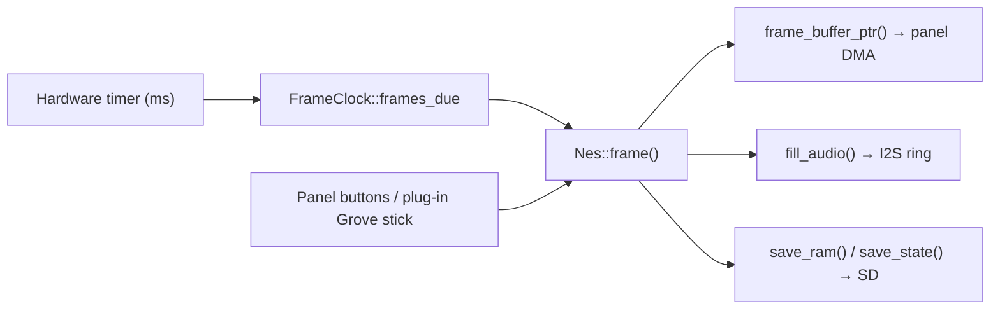

# Embedded Handheld Plan

[简体中文](./embedded-handheld.zh-CN.md) · **English**

This document plans a DIY embedded handheld built on `nes-core`: what the core already gives
a microcontroller host, what it costs in RAM and bandwidth, which off-the-shelf boards fit,
and the order in which to bring one up. The scope of this stage is a **dev board**; a custom
PCB and an enclosure come later and are only sketched out in section 8.

- Applies to: `main` (as of 2026-10-14)
- Stage: dev-board bring-up. No custom PCB, no enclosure.
- Constraints: **no soldering.** Board-mounted peripherals and plug-in (connectorized)
  accessories only.
- Numbers marked *measured* were taken on 2026-10-14 on an Apple Silicon host with a release
  build. Device-side numbers are targets that this plan exists to replace.

---

## 1. Why this port is plausible

The core was built for exactly this: it separates "what a NES is" from "how it is shown", and
the host contract is four channels — timestamps in, pixels out, buttons in, audio out.

| Fact | Source | Why it matters on an MCU |
| --- | --- | --- |
| Builds `no_std` | `cargo build -p nes-core --no-default-features` passes | Runs on bare metal; needs only an `alloc` heap |
| `FrameClock` takes monotonic milliseconds | `crates/nes-core/src/clock.rs` | A hardware timer plus `frames_due()` replaces `requestAnimationFrame` / `CADisplayLink` |
| Audio is pulled, not pushed | `Nes::fill_audio(&mut [f32])` | Matches an I2S DMA double buffer; the core never calls back into the host |
| Zero-copy picture handoff | `Nes::frame_buffer_ptr()` | The frame buffer can go straight to a DMA-capable peripheral |
| `Nes: Send` and `!Sync`, no threads, no locks | `crates/nes-core/tests/host_contract.rs` | Fits a single-owner main loop; the MCU needs no synchronization primitives |
| 51 mappers | `supported_mappers()` | Covers the common commercial library |

*Measured*: one frame costs **~357 µs** in a release build on an Apple Silicon host
(`cargo bench -p nes-core --bench benchmark -- frame_execution`), about 46× real time on the
host's out-of-order cores. That ratio does not transfer to a 240 MHz in-order MCU, which is
the reason phase 0 of section 5 measures the same thing on the target.

## 2. Resource budget

The core's resident footprint is fixed and known, and it is what rules boards in or out.

| Item | Size | Where it comes from |
| --- | --- | --- |
| Frame buffer (256×240, `u32` ARGB) | 240 KiB | `ppu/rendering.rs`, `FrameBuffer::pixels` |
| Background mask buffer (`Vec<u8>`) | 60 KiB | `BackgroundRenderer::bg_pixels` |
| Sprite mask buffer (`Vec<u8>`) | 60 KiB | `SpriteEvaluator::sprite_pixels` |
| Audio ring (500 ms at 48 kHz, stereo `f32`) | 188 KiB | `Nes::audio_buffer`; `AUDIO_BUFFER_MS = 500` |
| **Fixed subtotal** | **~548 KiB** | before any cartridge or save state |
| Cartridge PRG + CHR | 0.3–2 MiB | Mappers own `Vec<u8>` copies; MMC5 accepts 1 MiB each |

So a host needs **roughly 0.6 MiB of fixed RAM plus 0.3–2 MiB for the cartridge**, and the
cartridge half is not optional: `create_mapper` takes `Vec<u8>`, so ROM data lands in RAM
rather than staying in memory-mapped flash.

Consequences:

- A board without PSRAM cannot run the core unmodified. RP2350 (520 KiB SRAM) and ESP32-S3
  modules that ship without PSRAM are out unless the core is slimmed down first (section 6).
- PSRAM is the right home for the audio ring and the cartridge copy. The frame buffer wants
  to stay in fast internal RAM, because every pixel is written once per frame.

## 3. The binding constraint: display bandwidth

Frame size × 2 bytes (RGB565) × 60 Hz is the number that decides the whole design:

| Panel | Bytes per frame | Required at 60 Hz | SPI at 80 MHz (~10 MB/s) | Parallel 8-bit i80 / 16-bit RGB |
| --- | --- | --- | --- | --- |
| 256×240 (NES 1:1) | 120 KiB | 7.2 MB/s | 12.3 ms/frame (~81% busy) | trivial |
| 320×240 (1:1 plus side bars) | 150 KiB | 9.2 MB/s | 15.4 ms/frame (~92% busy) | trivial |
| 640×480 (NES 2×) | 600 KiB | 36 MB/s | impossible | a few tens of MHz pixel clock |

Two conclusions:

- **Every solder-free dev board in section 4 drives its panel over SPI**, so none of them
  holds 60 fps with a full-frame blit. Expect 30–45 fps at an aggressive SPI clock. NES games
  scroll the entire screen every frame, so dirty-rectangle tricks will not close the gap.
- The dev-board stage therefore validates *correctness, audio, input and memory*, not display
  throughput. **Display bandwidth has to be settled on a parallel (i80/RGB) panel**, which is
  exactly why the final panel choice belongs to the PCB stage.

## 4. Hardware shortlist

Verified against vendor repositories and documentation on 2026-10-14; see section 9 for what
still needs checking.

| Board | SoC / RAM | Panel | Audio | Storage / power | Verdict |
| --- | --- | --- | --- | --- | --- |
| M5Stack CoreS3 | ESP32-S3, 16 MB flash + 8 MB PSRAM | 320×240 ILI9342C (SPI) | Onboard speaker + AW88298 amp, ES7210 mic | microSD, AXP2101 PMIC + battery | **Recommended**: everything onboard, Grove I2C for a plug-in stick |
| LilyGO T-Deck | ESP32-S3, 16 MB flash + 8 MB PSRAM | 2.8" 320×240 ST7789 (SPI) | Onboard speaker + mic | Battery ADC, 16 MB flash | Best handheld *shape*; input is a keyboard + trackball, not a d-pad |
| Espressif ESP32-S3-BOX-3 | ESP32-S3 | 2.4" LCD | ES8311 codec + speaker (vendor docs) | — | Use as the audio reference; too few buttons to play on |
| Waveshare ESP32-S3-Touch-LCD-3.5 | ESP32-S3 | 3.5" (SPI) | none | — | Panel and touch only; no speaker, no buttons |
| M5Stack Cardputer | ESP32-S3**FN8**: 8 MB flash, **no PSRAM** | 1.14" 135×240 | NS4168 amp | microSD, 120 mAh + base battery | **Excluded**: no PSRAM, and the panel is too small |
| Raspberry Pi PicoSystem | RP2040 | small LCD | yes | battery | **Excluded**: 264 KiB SRAM, no PSRAM, no FPU |

Solder-free input: a Grove (HY2.0-4P) I2C stick or button unit plugs straight into the CoreS3's
PORT.A, so the whole rig is a board, a plug-in stick and a USB-C cable.

## 5. Bring-up plan

Each phase ends in a number, not a feeling.

**Phase 0 — correctness baseline, no peripherals (3–5 days).**
Build a board-agnostic host layer and run 300 frames of a homebrew ROM, printing a per-frame
FNV hash over the frame buffer. Compare against the same hash computed on the host: agreement
means the `no_std` port reproduces the reference machine, and it needs no screen, speaker or
enclosure. Record `Nes::frame()` cost per frame in a release build at the same time.
Deliverable: a hash log from both sides and one timing number.

**Phase 1 — picture and sound (1–2 weeks).**
On the CoreS3: SPI panel up, `fill_audio` into an I2S DMA double buffer, ROM read from the
microSD card, input from the plug-in Grove stick.

**Phase 2 — soak (3–5 days).**
Thirty minutes continuous, watching the PSRAM low-water mark, frame-time variance and audio
underruns.

**Phase 3 — optional shape check.**
Move to the T-Deck to judge handheld ergonomics, or skip it.

**Phase 4 — display verdict.**
Re-run phase 1 on a parallel-panel board (for example the Sunton ESP32-8048S043 / 8048S050
class — not verified here, confirm the panel interface, PSRAM size and pinout before buying).
Only then pick the final SoC and panel pairing.

The five numbers to record:

| Metric | Target | Why |
| --- | --- | --- |
| `Nes::frame()` per frame | < 10 ms | Leaves room in the 16.7 ms budget |
| Convert + blit per frame | < 4 ms | Display path cost |
| PSRAM low-water mark | no allocation failure | An MCU allocation failure is a panic |
| Average current | note it | Battery sizing later |
| Audio underruns | 0 | Determines the ring size |

**Gate.** If `frame()` plus a full-frame blit exceeds ~14 ms, 240 MHz is not enough. The
options are then: specialize mapper dispatch (removes a `dyn` virtual call per memory access),
emit palette indices instead of `u32` (section 6), or move up to ESP32-P4 / STM32H7.

## 6. Core changes this port needs

Ranked by payoff per line of code.

| # | Change | Saves / gains |
| --- | --- | --- |
| 1 | Add `PixelFormat::Rgb565`, or `Palette8` plus a 64-entry LUT | 240 KiB → 60 KiB frame buffer, and a memcpy-class blit instead of a per-pixel conversion. `PixelFormat` already exposes `id()` / `bytes_per_pixel()` / `bit_positions()`, so the change is contained |
| 2 | Make `AUDIO_BUFFER_MS` a `Config` field | 500 ms → 120 ms drops the reserve from 188 KiB to 30 KiB at 32 kHz |
| 3 | Optional borrowed cartridge storage (`&'static [u8]`) | Removes the 0.3–2 MiB ROM copy; the difference between running and not running on a small-RAM board |
| 4 | An `audio` feature flag | Trims APU cost and flash for a silent build, and lets phase 0 land sooner |
| 5 | Specialize mapper dispatch | `dyn Mapper` costs a virtual call on every memory access (`docs/architecture.md` §15.3) |
| 6 | `f32` or integer `FrameClock` | Cortex-M33 has a single-precision FPU only, so the current `f64` pacing runs in soft float |

Items 1 and 2 are the prerequisites for a comfortable MCU port, and both are independent of
which board is chosen.

## 7. Risks

- **Display bandwidth** — the largest one; see section 3. Mitigation: a parallel panel for any
  final build.
- **PSRAM latency** — a `u32` frame buffer written into PSRAM will not keep up. Keep it in
  internal RAM, or drop to 8-bit palette indices.
- **Toolchain friction** — ESP32-S3 is Xtensa and needs `espup` plus a forked LLVM. A
  mainline-Rust path means RISC-V (ESP32-P4 / C6) or ARM (RP2350).
- **Accuracy regressions** — the blargg suites and AccuracyCoin are the yardstick
  (`docs/architecture.md` §13.1). Re-run them against the flashed build, and check that the
  `no_std` and `std` builds produce identical frames.
- **ROM policy** — the firmware ships no ROMs, matching `DISCLAIMER.md`.

## 8. Deferred: PCB and enclosure

Out of scope here, but the pieces worth reusing later:

- Full open-source handheld CAD plus PCBs: [Retro Lite CM4](https://github.com/StonedEdge/Retro-Lite-CM4)
  (376 stars, CC-BY-SA-4.0; its README states the CAD files are open source, and ships four
  custom PCBs) and [makermichael/PiBoy](https://github.com/makermichael/PiBoy) (CNC and STL
  files). Arduboy publishes CAD historically, but its GitHub path did not resolve correctly
  when checked, so treat any mirror of it as unverified.
- There is **no open-source injection mold**, and a mold is not something you 3D-print. The
  DIY equivalent is a printed master plus a silicone mold for 20–50 cast parts.
- Cheaper and better than printing a shell: buy a molded Game Boy / GBA replacement shell
  (¥20–40, buttons and silicone pads included) and print only the internal brackets, battery
  cradle and speaker chamber.
- Enclosure CAD is Nintendo trade dress: personal use is fine, selling is not. CC-BY-SA CAD
  requires attribution and share-alike, consistent with `DISCLAIMER.md`.

## 9. Verification log

| Claim | Status |
| --- | --- |
| `no_std` build, `FrameClock`, `fill_audio`, memory budget, mapper count | Verified from source in this repository, 2026-10-14 |
| ~357 µs per frame (release, Apple Silicon) | Measured 2026-10-14 |
| CoreS3 / T-Deck / Cardputer / ESP32-S3-Touch-LCD-3.5 specs | Verified against vendor repositories and documentation, 2026-10-14 |
| `crates/nes-core/benches/benchmark.rs:47` climbs one directory too many, so the real-ROM benchmark has always been skipped silently | Verified 2026-10-14 |
| Panel interfaces and the audio codec on the ESP32-S3-BOX-3 | Taken from the vendor product line, not re-verified in this session |
| Sunton ESP32-8048S043 / 8048S050 availability and pinout | **Not verified** — check before buying |

## 10. References

- `docs/architecture.md` §10 — host integration contract, and §15.3 for the known hot spots
- `docs/architecture.md` §13.1 — the ROM accuracy baseline
- `crates/nes-core/tests/host_contract.rs` — the ownership promises a host relies on
- [M5Stack CoreS3 documentation](https://docs.m5stack.com/en/core/CoreS3)
- [LilyGO T-Deck](https://github.com/Xinyuan-LilyGO/T-Deck)
- [Espressif ESP-BOX](https://github.com/espressif/esp-box)
- [Waveshare ESP32-S3-Touch-LCD-3.5](https://github.com/waveshareteam/ESP32-S3-Touch-LCD-3.5)
- [M5Stack Cardputer documentation](https://docs.m5stack.com/en/core/Cardputer)
- [Retro Lite CM4](https://github.com/StonedEdge/Retro-Lite-CM4) · [PiBoy](https://github.com/makermichael/PiBoy)
