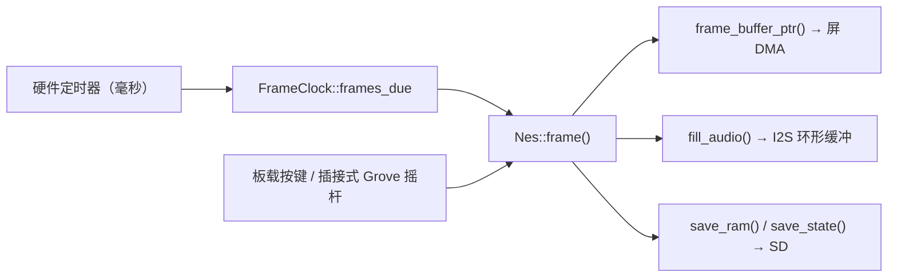

# 嵌入式掌机方案

**简体中文** · [English](./embedded-handheld.md)

本文规划一台基于 `nes-core` 的 DIY 嵌入式掌机：内核已经为单片机宿主准备好了什么、需要多少
内存与带宽、哪些现成开发板能对上、以及按什么顺序把它跑起来。本阶段的边界是**开发板**；
自制 PCB 与外壳属于后续阶段，这里只在第 8 节做备忘。

- 适用版本：`main`（截至 2026-10-14）
- 阶段：开发板 bring-up，不含自制 PCB 与外壳
- 约束：**不动手焊接**，只使用板载外设与插接式（带连接器）配件
- 标注*实测*的数字来自 2026-10-14 在一台 Apple Silicon 主机上的 release 构建；
  设备侧数字是待测目标，本方案的存在就是为了把它们测出来

---

## 1. 为什么这个移植是可行的

内核本来就是按这个前提写的：把"NES 是什么"和"如何呈现"彻底分开，宿主契约只有四条通道——
喂时间戳、取画面、送按键、拉音频。

| 事实 | 出处 | 对单片机的意义 |
| --- | --- | --- |
| 可以 `no_std` 编译 | `cargo build -p nes-core --no-default-features` 通过 | 能跑裸机，只需要一个 `alloc` 堆 |
| `FrameClock` 只吃单调毫秒 | `crates/nes-core/src/clock.rs` | 一个硬件定时器加 `frames_due()` 就替代了 `requestAnimationFrame` / `CADisplayLink` |
| 音频是宿主拉，不是回调推 | `Nes::fill_audio(&mut [f32])` | 与 I2S DMA 双缓冲天然对应；内核从不回调宿主 |
| 画面可以零拷贝交接 | `Nes::frame_buffer_ptr()` | 帧缓冲能直接交给支持 DMA 的外设 |
| `Nes: Send` 且 `!Sync`，无线程无锁 | `crates/nes-core/tests/host_contract.rs` | 契合"单一所有者主循环"，单片机侧不需要任何同步原语 |
| 支持 51 个 mapper | `supported_mappers()` | 覆盖常见商业 ROM |

*实测*：在 Apple Silicon 主机上 release 构建下单帧耗时 **约 357 µs**
（`cargo bench -p nes-core --bench benchmark -- frame_execution`），约等于主机实时速度的 46 倍。
这个比值**不能**平移到 240 MHz 的顺序执行 MCU 上，所以第 5 节的阶段 0 要在目标板上重测同一项。

## 2. 资源预算

内核的常驻开销是固定且已知的，它直接决定板子能不能用。

| 项目 | 大小 | 来源 |
| --- | --- | --- |
| 帧缓冲（256×240，`u32` ARGB） | 240 KiB | `ppu/rendering.rs`，`FrameBuffer::pixels` |
| 背景掩码缓冲（`Vec<u8>`） | 60 KiB | `BackgroundRenderer::bg_pixels` |
| 精灵掩码缓冲（`Vec<u8>`） | 60 KiB | `SpriteEvaluator::sprite_pixels` |
| 音频环（48 kHz 立体声 `f32`，500 ms） | 188 KiB | `Nes::audio_buffer`；`AUDIO_BUFFER_MS = 500` |
| **固定小计** | **约 548 KiB** | 还不含卡带与即时存档 |
| 卡带 PRG + CHR | 0.3–2 MiB | mapper 持有 `Vec<u8>` 拷贝；MMC5 上限各 1 MiB |

也就是说，宿主需要**约 0.6 MiB 固定内存，再加 0.3–2 MiB 的卡带空间**，而且卡带这部分省不掉：
`create_mapper` 收的是 `Vec<u8>`，ROM 数据会落进 RAM，而不是留在内存映射的 Flash 里。

由此得出两条结论：

- 没有 PSRAM 的板子跑不动未改造的内核。RP2350（520 KiB SRAM）和不带 PSRAM 的 ESP32-S3 模组
  都出局——除非先按第 6 节把内核瘦下来。
- 音频环和卡带拷贝适合放 PSRAM；帧缓冲则要留在快速内部 RAM，因为每帧每个像素都要写一次。

## 3. 真正的约束：显示带宽

画面尺寸 × 2 字节（RGB565）× 60 Hz，这个数决定了整套设计：

| 屏幕 | 单帧字节数 | 60 Hz 需求 | SPI @80 MHz（约 10 MB/s） | 并口 8-bit i80 / 16-bit RGB |
| --- | --- | --- | --- | --- |
| 256×240（NES 1:1） | 120 KiB | 7.2 MB/s | 12.3 ms/帧（占用约 81%） | 轻松 |
| 320×240（1:1 加左右留边） | 150 KiB | 9.2 MB/s | 15.4 ms/帧（占用约 92%） | 轻松 |
| 640×480（NES 2×） | 600 KiB | 36 MB/s | 不可能 | 需要几十 MHz 像素时钟 |

两条结论：

- **第 4 节里所有免焊接开发板都是 SPI 屏**，因此没有一块能在整屏刷新下跑满 60 fps；
  把 SPI 时钟拉到极限也就 30–45 fps。NES 游戏几乎每帧整屏滚动，dirty-rect 之类的技巧补不上这个缺口。
- 所以开发板阶段验证的是*逻辑正确、音频、输入、内存*，**不是**显示吞吐。
  **显示带宽必须在并口（i80/RGB）屏上做定论**——这也正是最终选屏要留到 PCB 阶段的原因。

## 4. 硬件短名单

以下规格已在 2026-10-14 对照厂商仓库与文档核实；仍需自己确认的部分见第 9 节。

| 板子 | SoC / 内存 | 屏幕 | 音频 | 存储 / 供电 | 结论 |
| --- | --- | --- | --- | --- | --- |
| M5Stack CoreS3 | ESP32-S3，16 MB Flash + 8 MB PSRAM | 320×240 ILI9342C（SPI） | 板载喇叭 + AW88298 功放、ES7210 麦克风 | microSD、AXP2101 电源管理 + 电池 | **推荐**：外设全板载，PORT.A 的 Grove I2C 可直接插摇杆 |
| LilyGO T-Deck | ESP32-S3，16 MB Flash + 8 MB PSRAM | 2.8" 320×240 ST7789（SPI） | 板载喇叭 + 麦克风 | 电池检测 ADC、16 MB Flash | 掌机**形态**最像；但输入是键盘 + 触摸板，不是方向键 |
| Espressif ESP32-S3-BOX-3 | ESP32-S3 | 2.4" LCD | ES8311 编解码 + 喇叭（厂商资料） | — | 当音频对照板用；按键太少，不适合玩 |
| Waveshare ESP32-S3-Touch-LCD-3.5 | ESP32-S3 | 3.5"（SPI） | 无 | — | 只有屏和触摸，没喇叭没按键 |
| M5Stack Cardputer | ESP32-S3**FN8**：8 MB Flash，**无 PSRAM** | 1.14" 135×240 | NS4168 功放 | microSD、120 mAh + 底座电池 | **排除**：无 PSRAM，屏幕也太小 |
| Raspberry Pi PicoSystem | RP2040 | 小尺寸 LCD | 有 | 电池 | **排除**：264 KiB SRAM、无 PSRAM、无 FPU |

免焊接输入：Grove（HY2.0-4P）I2C 摇杆或按键单元直接插进 CoreS3 的 PORT.A，
整套东西就是一块板 + 一个插接摇杆 + 一根 USB-C 线。

## 5. Bring-up 计划

每个阶段都以一个数字收尾，而不是以"感觉可以"收尾。

**阶段 0 — 无需外设的正确性基线（3–5 天）**
写一层与板级无关的宿主代码，跑 300 帧 homebrew ROM，输出逐帧的帧缓冲 FNV 哈希，
与主机侧算出的同一个哈希对照：一致就说明 `no_std` 移植复现了参考机。
这一步不需要屏、喇叭和外壳。同时记录 release 构建下 `Nes::frame()` 的单帧耗时。
交付物：两侧的哈希日志，以及一个耗时数字。

**阶段 1 — 出画面、出声音（1–2 周）**
在 CoreS3 上：点亮 SPI 屏、把 `fill_audio` 灌进 I2S DMA 双缓冲、从 microSD 读 ROM、
用插接式 Grove 摇杆做输入。

**阶段 2 — 稳定性（3–5 天）**
连续运行 30 分钟，盯 PSRAM 最低水位、帧耗时方差与音频欠载次数。

**阶段 3 — 形态验证（可选）**
换到 T-Deck 上评估握持与手感，不需要就跳过。

**阶段 4 — 显示结论**
在并口屏板子上重跑阶段 1（例如 Sunton ESP32-8048S043 / 8048S050 这一类——
本文未能核实，购买前请自行确认屏幕接口、PSRAM 容量与引脚定义）。
到这里才确定最终的 SoC + 屏幕组合。

需要记录的五个数字：

| 指标 | 目标 | 理由 |
| --- | --- | --- |
| `Nes::frame()` 单帧耗时 | < 10 ms | 在 16.7 ms 预算里留出余量 |
| 格式转换 + 刷屏耗时 | < 4 ms | 显示链路开销 |
| PSRAM 最低水位 | 不出现分配失败 | 单片机上分配失败就是 panic |
| 平均电流 | 记录下来 | 后续电池选型依据 |
| 音频欠载次数 | 0 | 决定音频环留多大 |

**阶段门**：如果 `frame()` 加整屏刷新超过约 14 ms，就说明 240 MHz 这一档不够。出路是：
把 mapper 分发特化（省掉每次内存访问的 `dyn` 虚调用）、输出调色板索引而不是 `u32`（第 6 节），
或者升到 ESP32-P4 / STM32H7。

## 6. 这次移植需要的内核改动

按"每行代码的收益"排序。

| # | 改动 | 省下 / 换来 |
| --- | --- | --- |
| 1 | 新增 `PixelFormat::Rgb565`，或 `Palette8` + 64 项 LUT | 帧缓冲 240 KiB → 60 KiB，且刷屏变成 memcpy 级别，而不是逐像素转换。`PixelFormat` 已经暴露 `id()` / `bytes_per_pixel()` / `bit_positions()`，所以是收敛改动 |
| 2 | 把 `AUDIO_BUFFER_MS` 变成 `Config` 字段 | 500 ms → 120 ms 时，32 kHz 下预留从 188 KiB 降到 30 KiB |
| 3 | 可选的借用式卡带存储（`&'static [u8]`） | 省掉 0.3–2 MiB 的 ROM 拷贝；在小内存板子上这就是"能跑"和"跑不起来"的区别 |
| 4 | 加 `audio` feature 开关 | 静音版可裁掉 APU 的算力与 Flash 占用，也让阶段 0 更早落地 |
| 5 | 特化 mapper 分发 | `dyn Mapper` 让每次内存访问都有一次虚调用（`docs/architecture.md` §15.3） |
| 6 | `f32` 或整数版 `FrameClock` | Cortex-M33 只有单精度 FPU，当前 `f64` 定时逻辑走的是软浮点 |

第 1、2 项是让 MCU 移植舒适的前提，而且与最终选哪块板子无关。

## 7. 风险

- **显示带宽**——最大的一项，见第 3 节。缓解方式：最终机器一定上并口屏。
- **PSRAM 延迟**——`u32` 帧缓冲写进 PSRAM 跟不上。要么留在内部 RAM，要么降到 8 位调色板索引。
- **工具链摩擦**——ESP32-S3 是 Xtensa，需要 `espup` 和定制 LLVM。想走纯 mainline Rust，
  就选 RISC-V（ESP32-P4 / C6）或 ARM（RP2350）。
- **精度回归**——blargg 套件与 AccuracyCoin 是标尺（`docs/architecture.md` §13.1）。
  刷到设备上后要重跑，并确认 `no_std` 与 `std` 两种构建产生完全一致的帧。
- **ROM 政策**——固件不内置任何 ROM，与 `DISCLAIMER.md` 一致。

## 8. 后续（暂缓）：PCB 与外壳

本文不展开，但值得先记账的部分：

- 完整开源的掌机 CAD + PCB：[Retro Lite CM4](https://github.com/StonedEdge/Retro-Lite-CM4)
  （376 star，CC-BY-SA-4.0；其 README 写明 CAD 文件已开源，并附带四块自制 PCB）与
  [makermichael/PiBoy](https://github.com/makermichael/PiBoy)（CNC 与 STL 文件）。
  Arduboy 历史上公开过 CAD，但核查时它的 GitHub 路径没能正确解析，任何镜像都按未核实对待。
- **不存在开源的注塑模具**，模具也不是能 3D 打印的东西。DIY 的等价物是：
  打印母模 + 翻硅胶模，做 20–50 件小批量。
- 比打印外壳更便宜也更好：买注塑的 Game Boy / GBA 替换壳（¥20–40，含按键与硅胶胶条），
  自己只打印内部支架、电池仓和喇叭腔。
- 外壳 CAD 属于任天堂的外观设计：自用没问题，售卖不行。CC-BY-SA 的 CAD 需要署名并同样开源，
  与 `DISCLAIMER.md` 的口径一致。

## 9. 核实记录

| 结论 | 状态 |
| --- | --- |
| `no_std` 构建、`FrameClock`、`fill_audio`、内存预算、mapper 数量 | 2026-10-14 由本仓库源码核实 |
| 单帧约 357 µs（release，Apple Silicon） | 2026-10-14 实测 |
| CoreS3 / T-Deck / Cardputer / ESP32-S3-Touch-LCD-3.5 规格 | 2026-10-14 对照厂商仓库与文档核实 |
| `crates/nes-core/benches/benchmark.rs:47` 多爬了一层目录，导致真 ROM 基准一直被静默跳过 | 2026-10-14 核实 |
| ESP32-S3-BOX-3 的屏幕接口与音频编解码型号 | 取自厂商产品线资料，本次未逐一复核 |
| Sunton ESP32-8048S043 / 8048S050 的在售情况与引脚定义 | **未核实**——购买前请自查 |

## 10. 参考

- `docs/architecture.md` §10 —— 宿主接入契约；§15.3 —— 已知的热点
- `docs/architecture.md` §13.1 —— ROM 精度基线
- `crates/nes-core/tests/host_contract.rs` —— 宿主依赖的所有权承诺
- [M5Stack CoreS3 文档](https://docs.m5stack.com/en/core/CoreS3)
- [LilyGO T-Deck](https://github.com/Xinyuan-LilyGO/T-Deck)
- [Espressif ESP-BOX](https://github.com/espressif/esp-box)
- [Waveshare ESP32-S3-Touch-LCD-3.5](https://github.com/waveshareteam/ESP32-S3-Touch-LCD-3.5)
- [M5Stack Cardputer 文档](https://docs.m5stack.com/en/core/Cardputer)
- [Retro Lite CM4](https://github.com/StonedEdge/Retro-Lite-CM4) · [PiBoy](https://github.com/makermichael/PiBoy)
